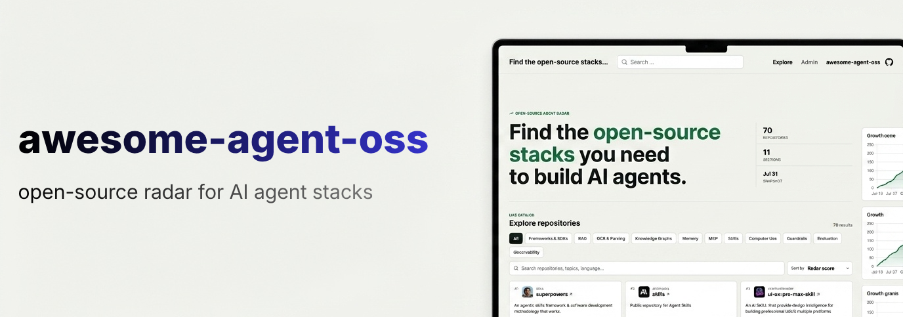

  

<h1 align="center">awesome-agent-oss</h1>

  Discover curated open-source tools for building AI agents and track how they grow over time.

  
  

  <a href="https://awesomeagent.vercel.app">
    <strong>Explore at Website &rarr;</strong>
  </a>

  <a href="#how-rankings-work">How Rankings Work</a>
  &nbsp;·&nbsp;
  <a href="https://github.com/skan0779/awesome-agent-oss/issues/new?template=repository-suggestion.yml">Suggest a Repository</a>

---

## How Rankings Work

- Repositories are discovered through GitHub topics and manually reviewed before publication.
- Stars, forks, releases, and repository activity are collected daily from the GitHub API.
- Radar Score combines overall adoption with star-growth signals across 1, 3, 7, 30, and 60 days.
- Newer repositories are ranked with lower confidence until enough daily history is available.

 

---

<!-- AWESOME_AGENT_OSS:START -->
_🚀 Last updated from snapshot: `2026-10-22 04:43 UTC`._

## [Trending This Week](https://awesomeagent.vercel.app/#trending)

| Rank | Repository | Stars 1d | Stars 7d | Total Stars |
| ---: | --- | ---: | ---: | ---: |
| 1 | [DietrichGebert/ponytail](https://github.com/DietrichGebert/ponytail) | +1,906 | +13,186 | 171,967 |
| 2 | [cathrynlavery/diagram-design](https://github.com/cathrynlavery/diagram-design) | +526 | +12,855 | 59,623 |
| 3 | [affaan-m/ECC](https://github.com/affaan-m/ECC) | +842 | +10,328 | 285,841 |
| 4 | [ifixai-ai/iFixAi](https://github.com/ifixai-ai/iFixAi) | +1,155 | +9,122 | 31,883 |
| 5 | [Graphify-Labs/graphify](https://github.com/Graphify-Labs/graphify) | +1,384 | +7,058 | 131,861 |
| 6 | [Leonxlnx/taste-skill](https://github.com/Leonxlnx/taste-skill) | +700 | +6,788 | 100,677 |
| 7 | [tt-a1i/archify](https://github.com/tt-a1i/archify) | +607 | +6,743 | 87,175 |
| 8 | [obra/superpowers](https://github.com/obra/superpowers) | +556 | +6,585 | 303,228 |
| 9 | [Panniantong/Agent-Reach](https://github.com/Panniantong/Agent-Reach) | +370 | +6,404 | 100,731 |
| 10 | [anthropics/claude-plugins-official](https://github.com/anthropics/claude-plugins-official) | +247 | +6,127 | 43,690 |

 

## [Frameworks & SDKs](./sections/frameworks.md)

Frameworks and SDKs for building, orchestrating, and running AI agents.

| Rank | Repository | Stars | Forks | Updated | Latest release | License |
| ---: | --- | ---: | ---: | --- | --- | --- |
| 1 | [ruvnet/ruflo](https://github.com/ruvnet/ruflo) | 78,250 | 9,208 | 2026-10-22 | v3.59.13 (2026-10-22) | MIT |
| 2 | [headroomlabs-ai/headroom](https://github.com/headroomlabs-ai/headroom) | 77,348 | 6,007 | 2026-10-22 | v0.41.0 (2026-10-14) | Apache-2.0 |
| 3 | [langchain-ai/langgraph](https://github.com/langchain-ai/langgraph) | 43,683 | 7,482 | 2026-10-22 | cli==0.4.37 (2026-10-19) | MIT |
| 4 | [langchain-ai/langchain](https://github.com/langchain-ai/langchain) | 148,235 | 24,878 | 2026-10-22 | langchain-core==1.6.13 (2026-10-21) | MIT |
| 5 | [Tracer-Cloud/opensre](https://github.com/Tracer-Cloud/opensre) | 12,361 | 1,809 | 2026-10-22 | v0.1.2026.10.22 (2026-10-22) | Apache-2.0 |
| 6 | [bytedance/deer-flow](https://github.com/bytedance/deer-flow) | 84,263 | 11,780 | 2026-10-22 | v2.1.0 (2026-09-24) | MIT |
| 7 | [ScrapeGraphAI/Scrapegraph-ai](https://github.com/ScrapeGraphAI/Scrapegraph-ai) | 32,108 | 3,284 | 2026-10-06 | v2.3.1 (2026-10-06) | MIT |
| 8 | [crewAIInc/crewAI](https://github.com/crewAIInc/crewAI) | 59,966 | 8,827 | 2026-10-21 | 1.15.28 (2026-10-14) | MIT |
| 9 | [pipecat-ai/pipecat](https://github.com/pipecat-ai/pipecat) | 16,702 | 2,936 | 2026-10-22 | v1.13.0 (2026-10-19) | BSD-2-Clause |
| 10 | [langchain-ai/deepagents](https://github.com/langchain-ai/deepagents) | 30,487 | 4,296 | 2026-10-22 | deepagents==0.7.30 (2026-10-22) | MIT |

## [Platforms & Apps](./sections/platforms-apps.md)

Self-hosted platforms and applications for building, deploying, and operating AI agents.

| Rank | Repository | Stars | Forks | Updated | Latest release | License |
| ---: | --- | ---: | ---: | --- | --- | --- |
| 1 | [farion1231/cc-switch](https://github.com/farion1231/cc-switch) | 147,351 | 9,717 | 2026-10-21 | v4.0.18 (2026-10-21) | MIT |
| 2 | [666ghj/MiroFish](https://github.com/666ghj/MiroFish) | 81,080 | 12,293 | 2026-10-16 | v0.1.2 (2026-03-07) | AGPL-3.0 |
| 3 | [HKUDS/DeepTutor](https://github.com/HKUDS/DeepTutor) | 42,049 | 5,331 | 2026-10-19 | v1.6.15 (2026-10-18) | Apache-2.0 |
| 4 | [n8n-io/n8n](https://github.com/n8n-io/n8n) | 208,268 | 61,218 | 2026-10-22 | n8n@2.44.5 (2026-10-21) | Other |
| 5 | [langgenius/dify](https://github.com/langgenius/dify) | 159,180 | 25,161 | 2026-10-22 | 1.17.1 (2026-09-10) | Other |
| 6 | [danny-avila/LibreChat](https://github.com/LibreChat-AI/LibreChat) | 46,137 | 9,480 | 2026-10-22 | - | MIT |
| 7 | [bytedance/deer-flow](https://github.com/bytedance/deer-flow) | 84,263 | 11,780 | 2026-10-22 | v2.1.0 (2026-09-24) | MIT |
| 8 | [Untrivial-ai/agent-orchestrator](https://github.com/OrchestratorInc/agent-orchestrator) | 13,468 | 1,854 | 2026-10-22 | v0.14.4 (2026-10-21) | Apache-2.0 |
| 9 | [Mintplex-Labs/anything-llm](https://github.com/Mintplex-Labs/anything-llm) | 67,415 | 7,553 | 2026-10-22 | v1.18.0 (2026-10-13) | MIT |
| 10 | [trycompai/crm](https://github.com/trycompai/crm) | 11,590 | 1,696 | 2026-10-20 | v1.15.3 (2026-08-21) | MIT |

## [AI Gateways](./sections/ai-gateways.md)

Gateways for routing, securing, observing, and managing access to AI model providers.

| Rank | Repository | Stars | Forks | Updated | Latest release | License |
| ---: | --- | ---: | ---: | --- | --- | --- |
| 1 | [maximhq/bifrost](https://github.com/maximhq/bifrost) | 9,005 | 1,443 | 2026-10-21 | ent-v2.3.2-base (2026-10-21) | Apache-2.0 |
| 2 | [Portkey-AI/gateway](https://github.com/Portkey-AI/gateway) | 13,245 | 1,350 | 2026-05-25 | v1.15.2 (2026-01-12) | MIT |
| 3 | [IBM/mcp-context-forge](https://github.com/IBM/mcp-context-forge) | 4,676 | 938 | 2026-10-21 | v1.1.0 (2026-10-20) | Apache-2.0 |
| 4 | [archestra-ai/archestra](https://github.com/archestra-ai/archestra) | 4,387 | 1,223 | 2026-10-22 | platform-v1.4.1 (2026-10-21) | Other |
| 5 | [Kong/kong](https://github.com/Kong/kong) | 44,285 | 5,234 | 2026-10-19 | 3.9.4 (2026-10-12) | Apache-2.0 |
| 6 | [mnfst/manifest](https://github.com/mnfst/llm-gateway) | 7,595 | 522 | 2026-10-21 | manifest@6.28.9 (2026-10-16) | MIT |
| 7 | [algorithmicsuperintelligence/optillm](https://github.com/algorithmicsuperintelligence/optillm) | 4,327 | 393 | 2026-10-11 | v0.4.0 (2026-09-28) | Apache-2.0 |

## [RAG](./sections/rag.md)

Retrieval, indexing, and generation tools for grounding AI applications in external knowledge.

| Rank | Repository | Stars | Forks | Updated | Latest release | License |
| ---: | --- | ---: | ---: | --- | --- | --- |
| 1 | [Tencent/WeKnora](https://github.com/Tencent/WeKnora) | 35,015 | 4,689 | 2026-10-22 | v0.8.3 (2026-10-14) | Other |
| 2 | [infiniflow/ragflow](https://github.com/infiniflow/ragflow) | 92,627 | 11,066 | 2026-10-22 | v1.0.0-rc2 (2026-10-16) | Apache-2.0 |
| 3 | [VectifyAI/PageIndex](https://github.com/VectifyAI/PageIndex) | 39,441 | 3,425 | 2026-10-21 | v0.4.4 (2026-10-19) | MIT |
| 4 | [HKUDS/RAG-Anything](https://github.com/HKUDS/RAG-Anything) | 23,982 | 2,802 | 2026-10-21 | v1.4.3 (2026-10-21) | MIT |
| 5 | [HKUDS/LightRAG](https://github.com/HKUDS/LightRAG) | 40,258 | 5,714 | 2026-10-20 | v1.5.7 (2026-09-02) | MIT |
| 6 | [LearningCircuit/local-deep-research](https://github.com/LearningCircuit/local-deep-research) | 9,378 | 879 | 2026-10-22 | v1.10.7 (2026-08-28) | MIT |
| 7 | [run-llama/llama_index](https://github.com/run-llama/llama_index) | 52,606 | 8,404 | 2026-10-21 | v0.14.25 (2026-09-21) | MIT |
| 8 | [microsoft/graphrag](https://github.com/microsoft/graphrag) | 36,409 | 3,864 | 2026-10-20 | v3.3.0 (2026-10-08) | MIT |
| 9 | [raphaelmansuy/edgequake](https://github.com/raphaelmansuy/edgequake) | 2,280 | 273 | 2026-10-22 | v0.36.0 (2026-10-19) | Apache-2.0 |
| 10 | [nageoffer/ragent](https://github.com/nageoffer/ragent) | 4,318 | 875 | 2026-10-15 | 1.1.0 (2026-08-11) | Apache-2.0 |

## [OCR & Parsing](./sections/ocr.md)

OCR, document extraction, layout analysis, and structured document conversion.

| Rank | Repository | Stars | Forks | Updated | Latest release | License |
| ---: | --- | ---: | ---: | --- | --- | --- |
| 1 | [microsoft/markitdown](https://github.com/microsoft/markitdown) | 191,519 | 14,266 | 2026-10-21 | v0.1.9 (2026-10-21) | MIT |
| 2 | [opendatalab/MinerU](https://github.com/opendatalab/MinerU) | 82,238 | 6,806 | 2026-10-19 | mineru-4.0.12-released (2026-10-11) | Other |
| 3 | [docling-project/docling](https://github.com/docling-project/docling) | 69,315 | 5,144 | 2026-10-21 | v2.141.0 (2026-10-20) | MIT |
| 4 | [PaddlePaddle/PaddleOCR](https://github.com/PaddlePaddle/PaddleOCR) | 91,494 | 11,536 | 2026-09-16 | v3.7.0 (2026-06-11) | Apache-2.0 |
| 5 | [firecrawl/anydoc](https://github.com/firecrawl/anydoc) | 23,026 | 1,487 | 2026-10-20 | v0.2.4 (2026-08-27) | MIT |
| 6 | [HKUDS/RAG-Anything](https://github.com/HKUDS/RAG-Anything) | 23,982 | 2,802 | 2026-10-21 | v1.4.3 (2026-10-21) | MIT |
| 7 | [hiroi-sora/Umi-OCR](https://github.com/hiroi-sora/Umi-OCR) | 48,095 | 4,692 | 2025-11-20 | v2.1.5 (2025-03-25) | MIT |
| 8 | [chrisryugj/kordoc](https://github.com/chrisryugj/kordoc) | 2,650 | 472 | 2026-10-21 | v4.24.1 (2026-10-21) | MIT |
| 9 | [opendataloader-project/opendataloader-pdf](https://github.com/opendataloader-project/opendataloader-pdf) | 29,780 | 2,828 | 2026-10-22 | v2.5.14 (2026-10-21) | Apache-2.0 |
| 10 | [tesseract-ocr/tesseract](https://github.com/tesseract-ocr/tesseract) | 77,103 | 10,852 | 2026-10-22 | 5.5.3 (2026-07-24) | Apache-2.0 |

## [Knowledge Graphs](./sections/knowledge-graph.md)

Knowledge graph, graph database, and graph retrieval tools for AI applications.

| Rank | Repository | Stars | Forks | Updated | Latest release | License |
| ---: | --- | ---: | ---: | --- | --- | --- |
| 1 | [Graphify-Labs/graphify](https://github.com/Graphify-Labs/graphify) | 131,861 | 12,655 | 2026-10-21 | v0.9.93 (2026-10-20) | Apache-2.0 |
| 2 | [Egonex-AI/Understand-Anything](https://github.com/Egonex-AI/Understand-Anything) | 87,530 | 7,385 | 2026-10-21 | v2.9.0 (2026-07-10) | MIT |
| 3 | [FalkorDB/FalkorDB](https://github.com/FalkorDB/FalkorDB) | 10,499 | 587 | 2026-10-22 | v6.0.2 (2026-10-08) | Other |
| 4 | [getzep/graphiti](https://github.com/getzep/graphiti) | 32,122 | 3,300 | 2026-10-21 | v0.31.2 (2026-10-20) | Apache-2.0 |
| 5 | [semantica-agi/semantica](https://github.com/semantica-agi/semantica) | 14,175 | 1,657 | 2026-10-22 | v0.7.0 (2026-09-22) | MIT |
| 6 | [microsoft/graphrag](https://github.com/microsoft/graphrag) | 36,409 | 3,864 | 2026-10-20 | v3.3.0 (2026-10-08) | MIT |
| 7 | [raphaelmansuy/edgequake](https://github.com/raphaelmansuy/edgequake) | 2,280 | 273 | 2026-10-22 | v0.36.0 (2026-10-19) | Apache-2.0 |
| 8 | [open-metadata/OpenMetadata](https://github.com/open-metadata/OpenMetadata) | 15,546 | 2,469 | 2026-10-22 | 2.0.6-release (2026-10-21) | Apache-2.0 |
| 9 | [HelixDB/helix-db](https://github.com/HelixDB/helix-db) | 6,223 | 391 | 2026-10-21 | v3.5.1 (2026-10-08) | Apache-2.0 |
| 10 | [surrealdb/surrealdb](https://github.com/surrealdb/surrealdb) | 33,216 | 1,393 | 2026-10-19 | v3.3.4 (2026-10-19) | Other |

## [Memory](./sections/memory.md)

Short-term, long-term, and persistent memory systems for AI agents.

| Rank | Repository | Stars | Forks | Updated | Latest release | License |
| ---: | --- | ---: | ---: | --- | --- | --- |
| 1 | [vectorize-io/hindsight](https://github.com/vectorize-io/hindsight) | 52,454 | 6,200 | 2026-10-21 | v1.1.0 (2026-10-21) | MIT |
| 2 | [thedotmack/claude-mem](https://github.com/thedotmack/claude-mem) | 102,177 | 9,001 | 2026-10-21 | v15.0.1 (2026-10-20) | Apache-2.0 |
| 3 | [TencentCloud/TencentDB-Agent-Memory](https://github.com/TencentCloud/TencentDB-Agent-Memory) | 29,766 | 2,886 | 2026-10-21 | v2.0.3-beta.1 (2026-10-13) | Other |
| 4 | [volcengine/OpenViking](https://github.com/volcengine/OpenViking) | 40,545 | 3,271 | 2026-10-22 | v0.5.1.1 (2026-10-20) | AGPL-3.0 |
| 5 | [DeusData/codebase-memory-mcp](https://github.com/DeusData/codebase-memory-mcp) | 47,140 | 3,868 | 2026-10-22 | v0.12.1 (2026-10-16) | MIT |
| 6 | [topoteretes/cognee](https://github.com/topoteretes/cognee) | 32,639 | 3,395 | 2026-10-21 | v1.6.5 (2026-10-16) | Apache-2.0 |
| 7 | [mem0ai/mem0](https://github.com/mem0ai/mem0) | 67,605 | 7,981 | 2026-10-21 | ts-v3.3.1 (2026-09-25) | Apache-2.0 |
| 8 | [rohitg00/agentmemory](https://github.com/rohitg00/agentmemory) | 29,767 | 2,629 | 2026-10-21 | v0.9.30 (2026-10-06) | Apache-2.0 |
| 9 | [getzep/graphiti](https://github.com/getzep/graphiti) | 32,122 | 3,300 | 2026-10-21 | v0.31.2 (2026-10-20) | Apache-2.0 |
| 10 | [semantica-agi/semantica](https://github.com/semantica-agi/semantica) | 14,175 | 1,657 | 2026-10-22 | v0.7.0 (2026-09-22) | MIT |

## [MCP](./sections/mcp.md)

Model Context Protocol servers, clients, SDKs, registries, and tool integrations.

| Rank | Repository | Stars | Forks | Updated | Latest release | License |
| ---: | --- | ---: | ---: | --- | --- | --- |
| 1 | [DeusData/codebase-memory-mcp](https://github.com/DeusData/codebase-memory-mcp) | 47,140 | 3,868 | 2026-10-22 | v0.12.1 (2026-10-16) | MIT |
| 2 | [ChromeDevTools/chrome-devtools-mcp](https://github.com/ChromeDevTools/chrome-devtools-mcp) | 53,962 | 6,619 | 2026-10-22 | chrome-devtools-mcp-v1.11.0 (2026-10-15) | Apache-2.0 |
| 3 | [bethington/ghidra-mcp](https://github.com/bethington/ghidra-mcp) | 5,834 | 343 | 2026-10-21 | v7.0.0 (2026-10-21) | Apache-2.0 |
| 4 | [punkpeye/awesome-mcp-servers](https://github.com/punkpeye/awesome-mcp-servers) | 96,719 | 18,220 | 2026-10-18 | - | MIT |
| 5 | [upstash/context7](https://github.com/upstash/context7) | 63,456 | 3,124 | 2026-10-21 | @upstash/context7-mcp@4.4.4 (2026-10-19) | MIT |
| 6 | [CoplayDev/unity-mcp](https://github.com/CoplayDev/unity-mcp) | 15,291 | 1,585 | 2026-10-19 | v10.3.0 (2026-10-04) | MIT |
| 7 | [mrexodia/ida-pro-mcp](https://github.com/mrexodia/ida-pro-mcp) | 13,077 | 1,574 | 2026-09-26 | 1.4.0 (2025-10-06) | MIT |
| 8 | [oraios/serena](https://github.com/oraios/serena) | 30,588 | 2,081 | 2026-10-20 | v2.1.0 (2026-10-19) | Other |
| 9 | [0x4m4/hexstrike-ai](https://github.com/0x4m4/hexstrike-ai) | 13,003 | 2,643 | 2026-08-03 | - | MIT |
| 10 | [github/github-mcp-server](https://github.com/github/github-mcp-server) | 33,836 | 5,211 | 2026-10-21 | v2.0.3 (2026-10-21) | MIT |

## [Skills](./sections/skills.md)

Reusable skills, instructions, and workflow packages for AI agents.

| Rank | Repository | Stars | Forks | Updated | Latest release | License |
| ---: | --- | ---: | ---: | --- | --- | --- |
| 1 | [DietrichGebert/ponytail](https://github.com/DietrichGebert/ponytail) | 171,967 | 9,356 | 2026-10-18 | v5.3.2 (2026-10-16) | MIT |
| 2 | [cathrynlavery/diagram-design](https://github.com/cathrynlavery/diagram-design) | 59,623 | 3,841 | 2026-10-21 | - | MIT |
| 3 | [affaan-m/ECC](https://github.com/affaan-m/ECC) | 285,841 | 42,400 | 2026-10-20 | v2.2.3 (2026-10-01) | MIT |
| 4 | [tt-a1i/archify](https://github.com/tt-a1i/archify) | 87,175 | 5,874 | 2026-10-21 | v3.2.0 (2026-10-19) | MIT |
| 5 | [Leonxlnx/taste-skill](https://github.com/Leonxlnx/taste-skill) | 100,677 | 6,811 | 2026-10-20 | v2.1.4 (2026-10-20) | MIT |
| 6 | [addyosmani/agent-skills](https://github.com/addyosmani/agent-skills) | 109,373 | 11,408 | 2026-10-13 | 0.6.13 (2026-10-13) | MIT |
| 7 | [obra/superpowers](https://github.com/obra/superpowers) | 303,228 | 27,024 | 2026-10-21 | v7.0.1 (2026-10-21) | MIT |
| 8 | [K-Dense-AI/scientific-agent-skills](https://github.com/K-Dense-AI/scientific-agent-skills) | 53,644 | 4,733 | 2026-10-19 | v2.72.0 (2026-10-01) | MIT |
| 9 | [anthropics/claude-plugins-official](https://github.com/anthropics/claude-plugins-official) | 43,690 | 4,604 | 2026-10-22 | - | Apache-2.0 |
| 10 | [blader/humanizer](https://github.com/blader/humanizer) | 59,362 | 4,710 | 2026-10-16 | v3.1.0 (2026-09-28) | MIT |

## [Coding Agents](./sections/coding-agents.md)

Agents and development tools for writing, reviewing, debugging, and maintaining software.

| Rank | Repository | Stars | Forks | Updated | Latest release | License |
| ---: | --- | ---: | ---: | --- | --- | --- |
| 1 | [alibaba/open-code-review](https://github.com/alibaba/open-code-review) | 47,961 | 3,512 | 2026-10-22 | v1.13.2 (2026-10-20) | Apache-2.0 |
| 2 | [ruvnet/ruflo](https://github.com/ruvnet/ruflo) | 78,250 | 9,208 | 2026-10-22 | v3.59.13 (2026-10-22) | MIT |
| 3 | [Untrivial-ai/agent-orchestrator](https://github.com/OrchestratorInc/agent-orchestrator) | 13,468 | 1,854 | 2026-10-22 | v0.14.4 (2026-10-21) | Apache-2.0 |
| 4 | [omnigent-ai/omnigent](https://github.com/omnigent-ai/omnigent) | 10,973 | 1,788 | 2026-10-22 | v0.19.1 (2026-10-21) | Apache-2.0 |
| 5 | [backnotprop/plannotator](https://github.com/backnotprop/plannotator) | 9,566 | 715 | 2026-10-22 | v0.28.25 (2026-10-21) | Apache-2.0 |
| 6 | [kirodotdev/KiroCrew](https://github.com/kirodotdev/KiroCrew) | 4,536 | 857 | 2026-10-22 | v0.9.0 (2026-10-16) | Apache-2.0 |
| 7 | [google-gemini/gemini-cli](https://github.com/google-gemini/gemini-cli) | 107,490 | 14,759 | 2026-10-22 | v0.65.0 (2026-10-20) | Apache-2.0 |
| 8 | [MinishLab/semble](https://github.com/MinishLab/semble) | 6,260 | 280 | 2026-10-16 | v0.7.0 (2026-10-16) | MIT |
| 9 | [getsentry/XcodeBuildMCP](https://github.com/getsentry/MobileBuildMCP) | 6,497 | 327 | 2026-10-22 | v2.7.1 (2026-09-23) | MIT |
| 10 | [potpie-ai/potpie](https://github.com/potpie-ai/potpie) | 5,748 | 686 | 2026-10-21 | v2.0.1 (2026-08-31) | Apache-2.0 |

## [Sandboxes](./sections/sandboxes.md)

Isolated runtimes and execution environments for safely running agent-generated code and tools.

| Rank | Repository | Stars | Forks | Updated | Latest release | License |
| ---: | --- | ---: | ---: | --- | --- | --- |
| 1 | [nolabs-ai/nono](https://github.com/nolabs-ai/nono) | 4,609 | 317 | 2026-10-21 | v0.80.0 (2026-10-13) | Apache-2.0 |
| 2 | [microsoft/Orchard](https://github.com/microsoft/Orchard-Agentic) | 553 | 43 | 2026-10-09 | - | MIT |

## [Computer Use](./sections/computer-use.md)

Browser, desktop, and GUI automation for agents that operate software.

| Rank | Repository | Stars | Forks | Updated | Latest release | License |
| ---: | --- | ---: | ---: | --- | --- | --- |
| 1 | [Panniantong/Agent-Reach](https://github.com/Panniantong/Agent-Reach) | 100,731 | 8,867 | 2026-10-20 | v1.5.0 (2026-06-11) | MIT |
| 2 | [trycua/cua](https://github.com/trycua/cua) | 30,604 | 2,216 | 2026-10-22 | cua-spacesd-v0.7.0 (2026-10-21) | MIT |
| 3 | [citrolabs/ego-lite](https://github.com/citrolabs/ego-lite) | 18,598 | 1,021 | 2026-10-22 | v2.1.0 (2026-10-16) | MIT |
| 4 | [browser-use/browser-use](https://github.com/browser-use/browser-use) | 118,796 | 13,198 | 2026-10-20 | 0.13.13 (2026-10-15) | MIT |
| 5 | [microsoft/playwright](https://github.com/microsoft/playwright) | 98,248 | 6,667 | 2026-10-22 | v1.64.1 (2026-10-14) | Apache-2.0 |
| 6 | [jackwener/OpenCLI](https://github.com/jackwener/OpenCLI) | 30,516 | 2,976 | 2026-10-20 | v2.0.2 (2026-10-20) | Apache-2.0 |
| 7 | [browserbase/stagehand](https://github.com/browserbase/stagehand) | 25,776 | 1,776 | 2026-10-22 | @browserbasehq/stagehand@3.7.3 (2026-08-28) | MIT |
| 8 | [browser-use/browser-harness](https://github.com/browser-use/browser-harness) | 18,551 | 1,827 | 2026-10-17 | v0.1.13 (2026-09-04) | MIT |
| 9 | [web-infra-dev/midscene](https://github.com/web-infra-dev/midscene) | 15,359 | 1,197 | 2026-10-22 | v1.16.2 (2026-10-21) | MIT |
| 10 | [nanobrowser/nanobrowser](https://github.com/nanobrowser/nanobrowser) | 14,146 | 1,505 | 2026-10-15 | v0.3.0 (2026-10-15) | Apache-2.0 |

## [Voice & Realtime](./sections/voice-realtime.md)

Speech, voice, and real-time multimodal systems for conversational AI agents.

| Rank | Repository | Stars | Forks | Updated | Latest release | License |
| ---: | --- | ---: | ---: | --- | --- | --- |
| 1 | [jamiepine/voicebox](https://github.com/jamiepine/voicebox) | 58,197 | 7,305 | 2026-10-07 | v0.5.0 (2026-04-25) | MIT |
| 2 | [pipecat-ai/pipecat](https://github.com/pipecat-ai/pipecat) | 16,702 | 2,936 | 2026-10-22 | v1.13.0 (2026-10-19) | BSD-2-Clause |
| 3 | [livekit/agents](https://github.com/livekit/agents) | 14,887 | 3,979 | 2026-10-22 | livekit-agents@1.8.8 (2026-10-15) | Apache-2.0 |
| 4 | [microsoft/VibeVoice](https://github.com/microsoft/VibeVoice) | 54,916 | 6,171 | 2026-10-08 | - | MIT |
| 5 | [kyutai-labs/pocket-tts](https://github.com/kyutai-labs/pocket-tts) | 9,992 | 1,065 | 2026-10-21 | v4.0.1 (2026-10-21) | MIT |
| 6 | [modelscope/FunASR](https://github.com/modelscope/FunASR) | 20,789 | 2,093 | 2026-10-21 | v1.4.16 (2026-09-18) | MIT |
| 7 | [huggingface/speech-to-speech](https://github.com/huggingface/speech-to-speech) | 13,520 | 1,666 | 2026-10-21 | v1.0.0 (2026-09-06) | Apache-2.0 |
| 8 | [TEN-framework/ten-framework](https://github.com/TEN-framework/ten-framework) | 11,188 | 1,368 | 2026-10-22 | 0.11.74 (2026-10-21) | Other |
| 9 | [supertone-inc/supertonic](https://github.com/supertone-oss-archive/supertonic) | 13,765 | 1,561 | 2026-09-09 | v2.0.0 (2026-01-06) | MIT |

## [Guardrails](./sections/guardrails.md)

Safety, validation, privacy, and security controls for LLM and agent applications.

| Rank | Repository | Stars | Forks | Updated | Latest release | License |
| ---: | --- | ---: | ---: | --- | --- | --- |
| 1 | [ifixai-ai/iFixAi](https://github.com/ifixai-ai/iFixAi) | 31,883 | 1,618 | 2026-10-21 | v4.2.1 (2026-10-21) | Apache-2.0 |
| 2 | [usestrix/strix](https://github.com/usestrix/strix) | 70,857 | 7,858 | 2026-10-22 | v1.7.0 (2026-10-05) | Apache-2.0 |
| 3 | [NVIDIA/SkillSpector](https://github.com/NVIDIA/SkillSpector) | 20,842 | 1,828 | 2026-10-21 | v2.13.0 (2026-10-16) | Apache-2.0 |
| 4 | [KeygraphHQ/shannon](https://github.com/KeygraphHQ/shannon) | 49,197 | 5,632 | 2026-10-15 | v3.4.0 (2026-10-06) | AGPL-3.0 |
| 5 | [0x4m4/hexstrike-ai](https://github.com/0x4m4/hexstrike-ai) | 13,003 | 2,643 | 2026-08-03 | - | MIT |
| 6 | [nolabs-ai/nono](https://github.com/nolabs-ai/nono) | 4,609 | 317 | 2026-10-21 | v0.80.0 (2026-10-13) | Apache-2.0 |
| 7 | [Tencent/AI-Infra-Guard](https://github.com/Tencent/AI-Infra-Guard) | 6,933 | 670 | 2026-10-22 | v4.6.7 (2026-10-22) | Apache-2.0 |
| 8 | [openai/codex-security](https://github.com/openai/codex-security) | 11,164 | 878 | 2026-10-22 | npm-v0.5.1 (2026-10-20) | Apache-2.0 |
| 9 | [NVIDIA/garak](https://github.com/NVIDIA/garak) | 9,636 | 1,392 | 2026-10-21 | v0.17.1 (2026-10-16) | Apache-2.0 |
| 10 | [NVIDIA-NeMo/Guardrails](https://github.com/NVIDIA-NeMo/Guardrails) | 7,341 | 878 | 2026-10-22 | v0.24.1 (2026-09-16) | Other |

## [Evaluation](./sections/evaluation.md)

Evaluation, benchmarking, testing, and scoring for LLM and agent systems.

| Rank | Repository | Stars | Forks | Updated | Latest release | License |
| ---: | --- | ---: | ---: | --- | --- | --- |
| 1 | [ifixai-ai/iFixAi](https://github.com/ifixai-ai/iFixAi) | 31,883 | 1,618 | 2026-10-21 | v4.2.1 (2026-10-21) | Apache-2.0 |
| 2 | [promptfoo/promptfoo](https://github.com/promptfoo/promptfoo) | 26,252 | 2,534 | 2026-10-22 | code-scan-action-0.2.2 (2026-10-08) | MIT |
| 3 | [comet-ml/opik](https://github.com/comet-ml/opik) | 22,815 | 1,885 | 2026-10-22 | 2.2.113 (2026-10-21) | Apache-2.0 |
| 4 | [confident-ai/deepeval](https://github.com/confident-ai/deepeval) | 19,025 | 2,111 | 2026-10-19 | python-v4.2.4 (2026-09-22) | Apache-2.0 |
| 5 | [mlflow/mlflow](https://github.com/mlflow/mlflow) | 28,482 | 6,497 | 2026-10-22 | v3.17.2 (2026-10-21) | Apache-2.0 |
| 6 | [vibrantlabsai/ragas](https://github.com/vibrantlabsai/ragas) | 16,113 | 1,767 | 2026-02-24 | v0.4.3 (2026-01-13) | Apache-2.0 |
| 7 | [UKGovernmentBEIS/inspect_ai](https://github.com/UKGovernmentBEIS/inspect_ai) | 3,059 | 843 | 2026-10-21 | 0.3.283 (2026-10-21) | MIT |
| 8 | [MatrAIx-ai/MatrAIx-Persona-8B](https://github.com/MatrAIx-ai/MatrAIx-Persona-8B) | 2,074 | 357 | 2026-09-18 | - | MIT |
| 9 | [Giskard-AI/giskard-oss](https://github.com/Giskard-AI/giskard-oss) | 5,916 | 552 | 2026-10-20 | giskard-agents/v1.0.5 (2026-10-20) | Apache-2.0 |
| 10 | [latitude-dev/latitude-llm](https://github.com/latitude-dev/latitude-llm) | 4,733 | 403 | 2026-10-21 | cli-4.0.1 (2026-10-09) | MIT |

## [Observability](./sections/observability.md)

Tracing, monitoring, and production analytics for LLM and agent systems.

| Rank | Repository | Stars | Forks | Updated | Latest release | License |
| ---: | --- | ---: | ---: | --- | --- | --- |
| 1 | [Tracer-Cloud/opensre](https://github.com/Tracer-Cloud/opensre) | 12,361 | 1,809 | 2026-10-22 | v0.1.2026.10.22 (2026-10-22) | Apache-2.0 |
| 2 | [langfuse/langfuse](https://github.com/langfuse/langfuse) | 36,156 | 4,039 | 2026-10-22 | v4.67.0 (2026-10-21) | Other |
| 3 | [comet-ml/opik](https://github.com/comet-ml/opik) | 22,815 | 1,885 | 2026-10-22 | 2.2.113 (2026-10-21) | Apache-2.0 |
| 4 | [getagentseal/codeburn](https://github.com/getagentseal/codeburn) | 11,544 | 888 | 2026-10-21 | mac-v0.9.27 (2026-10-11) | MIT |
| 5 | [Arize-ai/phoenix](https://github.com/Arize-ai/phoenix) | 11,942 | 1,231 | 2026-10-22 | arize-phoenix-v20.24.0 (2026-10-21) | Other |
| 6 | [mlflow/mlflow](https://github.com/mlflow/mlflow) | 28,482 | 6,497 | 2026-10-22 | v3.17.2 (2026-10-21) | Apache-2.0 |
| 7 | [SigNoz/signoz](https://github.com/SigNoz/signoz) | 32,424 | 2,549 | 2026-10-22 | v0.146.0 (2026-10-14) | Other |
| 8 | [langwatch/langwatch](https://github.com/langwatch/langwatch) | 4,986 | 418 | 2026-10-22 | langwatch-3.21.0 (2026-10-21) | Apache-2.0 |
| 9 | [builderz-labs/mission-control](https://github.com/builderz-labs/mission-control) | 6,382 | 118 | 2026-10-19 | v2.3.0 (2026-07-25) | MIT |
| 10 | [open-telemetry/opentelemetry-collector](https://github.com/open-telemetry/opentelemetry-collector) | 7,686 | 2,310 | 2026-10-22 | v0.163.0 (2026-10-14) | Apache-2.0 |

## [UI/UX](./sections/ui-ux.md)

User interfaces, clients, and workspaces for interacting with AI and agent systems.

| Rank | Repository | Stars | Forks | Updated | Latest release | License |
| ---: | --- | ---: | ---: | --- | --- | --- |
| 1 | [nextlevelbuilder/ui-ux-pro-max-skill](https://github.com/nextlevelbuilder/ui-ux-pro-max-skill) | 138,572 | 14,688 | 2026-10-21 | v2.15.0 (2026-08-13) | MIT |
| 2 | [nexu-io/open-design](https://github.com/nexu-io/open-design) | 103,138 | 11,816 | 2026-10-22 | open-design-v0.26.0 (2026-10-20) | Apache-2.0 |
| 3 | [open-webui/open-webui](https://github.com/open-webui/open-webui) | 156,388 | 22,769 | 2026-10-22 | v0.12.3 (2026-10-16) | Other |
| 4 | [JCodesMore/ai-website-cloner-template](https://github.com/JCodesMore/ai-website-cloner-template) | 37,135 | 5,445 | 2026-10-19 | v0.6.1 (2026-10-05) | MIT |
| 5 | [ibelick/ui-skills](https://github.com/ibelick/ui-skills) | 9,978 | 464 | 2026-10-20 | v0.2.3 (2026-06-22) | MIT |
| 6 | [CopilotKit/CopilotKit](https://github.com/CopilotKit/CopilotKit) | 38,168 | 4,758 | 2026-10-22 | channels/v0.11.1 (2026-10-16) | MIT |
| 7 | [assistant-ui/assistant-ui](https://github.com/assistant-ui/assistant-ui) | 12,663 | 1,269 | 2026-10-22 | @assistant-ui/react-generative-ui@0.1.5 (2026-10-19) | MIT |
| 8 | [nexu-io/html-anything](https://github.com/nexu-io/html-anything) | 9,203 | 881 | 2026-10-13 | - | Apache-2.0 |
| 9 | [langchain-ai/agent-chat-ui](https://github.com/langchain-ai/agent-chat-ui) | 3,237 | 694 | 2026-10-19 | - | MIT |
| 10 | [grab/cursor-talk-to-figma-mcp](https://github.com/grab/cursor-talk-to-figma-mcp) | 7,067 | 780 | 2026-07-26 | - | MIT |
<!-- AWESOME_AGENT_OSS:END -->
