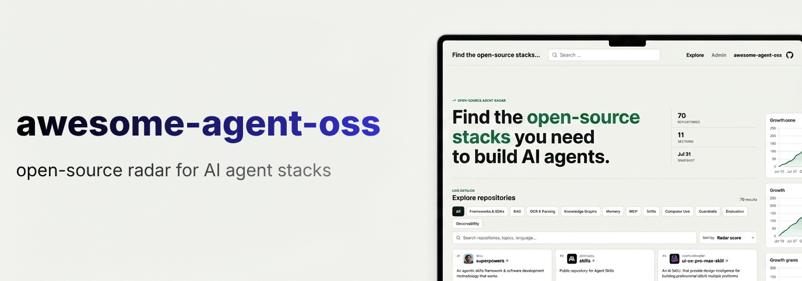

  

<h1 align="center">awesome-agent-oss</h1>

  Discover curated open-source tools for building AI agents and track how they grow over time.

  
  

  <a href="https://awesomeagent.vercel.app">
    <strong>Explore at Website &rarr;</strong>
  </a>

  <a href="#how-rankings-work">How Rankings Work</a>
  &nbsp;·&nbsp;
  <a href="https://github.com/skan0779/awesome-agent-oss/issues/new?template=repository-suggestion.yml">Suggest a Repository</a>

---

## How Rankings Work

- Repositories are discovered through GitHub topics and manually reviewed before publication.
- Stars, forks, releases, and repository activity are collected daily from the GitHub API.
- Radar Score combines overall adoption with star-growth signals across 1, 3, 7, 30, and 60 days.
- Newer repositories are ranked with lower confidence until enough daily history is available.

 

---

<!-- AWESOME_AGENT_OSS:START -->
_🚀 Last updated from snapshot: `2026-11-17 07:55 UTC`._

## [Trending This Week](https://awesomeagent.vercel.app/#trending)

| Rank | Repository | Stars 1d | Stars 7d | Total Stars |
| ---: | --- | ---: | ---: | ---: |
| 1 | [anthropics/skills](https://github.com/anthropics/skills) | +767 | +4,842 | 196,265 |
| 2 | [DietrichGebert/ponytail](https://github.com/DietrichGebert/ponytail) | +809 | +4,470 | 192,405 |
| 3 | [Leonxlnx/taste-skill](https://github.com/Leonxlnx/taste-skill) | +755 | +4,470 | 117,129 |
| 4 | [affaan-m/ECC](https://github.com/affaan-m/ECC) | +861 | +4,469 | 304,830 |
| 5 | [Nutlope/hallmark](https://github.com/Nutlope/hallmark) | +716 | +4,365 | 56,353 |
| 6 | [Graphify-Labs/graphify](https://github.com/Graphify-Labs/graphify) | +638 | +4,029 | 149,199 |
| 7 | [addyosmani/agent-skills](https://github.com/addyosmani/agent-skills) | +405 | +3,764 | 118,440 |
| 8 | [obra/superpowers](https://github.com/obra/superpowers) | +665 | +3,529 | 318,830 |
| 9 | [alibaba/open-code-review](https://github.com/alibaba/open-code-review) | +847 | +3,464 | 53,208 |
| 10 | [nextlevelbuilder/ui-ux-pro-max-skill](https://github.com/nextlevelbuilder/ui-ux-pro-max-skill) | +522 | +3,092 | 150,580 |

 

## [Frameworks & SDKs](./sections/frameworks.md)

Frameworks and SDKs for building, orchestrating, and running AI agents.

| Rank | Repository | Stars | Forks | Updated | Latest release | License |
| ---: | --- | ---: | ---: | --- | --- | --- |
| 1 | [headroomlabs-ai/headroom](https://github.com/headroomlabs-ai/headroom) | 79,867 | 6,259 | 2026-11-17 | v0.44.0 (2026-11-10) | Apache-2.0 |
| 2 | [ruvnet/ruflo](https://github.com/ruvnet/ruflo) | 81,906 | 9,660 | 2026-11-17 | v3.77.1 (2026-11-13) | MIT |
| 3 | [langchain-ai/langchain](https://github.com/langchain-ai/langchain) | 149,746 | 25,148 | 2026-11-17 | langchain-core==1.8.1 (2026-11-15) | MIT |
| 4 | [langchain-ai/langgraph](https://github.com/langchain-ai/langgraph) | 45,054 | 7,775 | 2026-11-17 | 1.2.22 (2026-11-14) | MIT |
| 5 | [crewAIInc/crewAI](https://github.com/crewAIInc/crewAI) | 61,011 | 9,211 | 2026-11-16 | 1.15.41 (2026-11-12) | MIT |
| 6 | [aaif-goose/goose](https://github.com/aaif-goose/goose) | 56,700 | 6,604 | 2026-11-17 | v1.59.2 (2026-11-16) | Apache-2.0 |
| 7 | [bytedance/deer-flow](https://github.com/bytedance/deer-flow) | 85,424 | 12,042 | 2026-11-17 | v2.2.0 (2026-11-04) | MIT |
| 8 | [langchain-ai/deepagents](https://github.com/langchain-ai/deepagents) | 31,346 | 4,428 | 2026-11-17 | deepagents==0.7.39 (2026-11-16) | MIT |
| 9 | [HKUDS/nanobot](https://github.com/HKUDS/nanobot) | 50,143 | 8,754 | 2026-11-17 | v0.4.1 (2026-11-06) | MIT |
| 10 | [ScrapeGraphAI/Scrapegraph-ai](https://github.com/ScrapeGraphAI/Scrapegraph-ai) | 32,826 | 3,352 | 2026-10-06 | v2.3.1 (2026-10-06) | MIT |

## [Platforms & Apps](./sections/platforms-apps.md)

Self-hosted platforms and applications for building, deploying, and operating AI agents.

| Rank | Repository | Stars | Forks | Updated | Latest release | License |
| ---: | --- | ---: | ---: | --- | --- | --- |
| 1 | [HKUDS/DeepTutor](https://github.com/HKUDS/DeepTutor) | 59,883 | 7,251 | 2026-11-15 | v1.7.3 (2026-11-15) | Apache-2.0 |
| 2 | [farion1231/cc-switch](https://github.com/farion1231/cc-switch) | 155,054 | 10,153 | 2026-11-17 | v4.0.33 (2026-11-16) | MIT |
| 3 | [666ghj/MiroFish](https://github.com/666ghj/MiroFish) | 85,796 | 13,015 | 2026-10-16 | v0.1.2 (2026-03-07) | AGPL-3.0 |
| 4 | [lobehub/lobehub](https://github.com/lobehub/lobehub) | 85,676 | 16,343 | 2026-11-17 | v2.3.3 (2026-11-12) | Other |
| 5 | [n8n-io/n8n](https://github.com/n8n-io/n8n) | 210,702 | 61,532 | 2026-11-17 | n8n@2.47.7 (2026-11-13) | Other |
| 6 | [langgenius/dify](https://github.com/langgenius/dify) | 161,326 | 25,516 | 2026-11-17 | 1.19.0 (2026-11-04) | Other |
| 7 | [Untrivial-ai/agent-orchestrator](https://github.com/OrchestratorInc/agent-orchestrator) | 14,828 | 2,039 | 2026-11-17 | v0.15.3 (2026-11-16) | Apache-2.0 |
| 8 | [nexu-io/html-anything](https://github.com/nexu-io/openmotion) | 10,098 | 981 | 2026-11-17 | - | Apache-2.0 |
| 9 | [andrewyng/openworker](https://github.com/andrewyng/openworker) | 19,403 | 2,766 | 2026-11-16 | v0.3.1 (2026-10-05) | MIT |
| 10 | [agentscope-ai/QwenPaw](https://github.com/agentscope-ai/QwenPaw) | 37,844 | 3,291 | 2026-11-17 | v2.3.0 (2026-11-11) | Apache-2.0 |

## [AI Gateways](./sections/ai-gateways.md)

Gateways for routing, securing, observing, and managing access to AI model providers.

| Rank | Repository | Stars | Forks | Updated | Latest release | License |
| ---: | --- | ---: | ---: | --- | --- | --- |
| 1 | [maximhq/bifrost](https://github.com/maximhq/bifrost) | 9,654 | 1,607 | 2026-11-17 | ent-v2.5.2-base (2026-11-15) | Apache-2.0 |
| 2 | [IBM/mcp-context-forge](https://github.com/IBM/mcp-context-forge) | 4,836 | 974 | 2026-11-17 | v1.1.1 (2026-11-10) | Apache-2.0 |
| 3 | [Portkey-AI/gateway](https://github.com/Portkey-AI/gateway) | 13,390 | 1,382 | 2026-05-25 | v1.15.2 (2026-01-12) | MIT |
| 4 | [Kong/kong](https://github.com/Kong/kong) | 44,388 | 5,241 | 2026-11-17 | 3.9.4 (2026-10-12) | Apache-2.0 |
| 5 | [mnfst/manifest](https://github.com/mnfst/llm-gateway) | 7,639 | 530 | 2026-11-16 | manifest@6.29.1 (2026-11-09) | MIT |
| 6 | [archestra-ai/archestra](https://github.com/archestra-ai/archestra) | 4,445 | 1,234 | 2026-11-17 | platform-v1.4.32 (2026-11-15) | Other |
| 7 | [algorithmicsuperintelligence/optillm](https://github.com/algorithmicsuperintelligence/optillm) | 4,346 | 401 | 2026-11-16 | v0.4.1 (2026-11-02) | Apache-2.0 |

## [RAG](./sections/rag.md)

Retrieval, indexing, and generation tools for grounding AI applications in external knowledge.

| Rank | Repository | Stars | Forks | Updated | Latest release | License |
| ---: | --- | ---: | ---: | --- | --- | --- |
| 1 | [Tencent/WeKnora](https://github.com/Tencent/WeKnora) | 37,622 | 5,232 | 2026-11-16 | v0.9.0 (2026-10-29) | Other |
| 2 | [infiniflow/ragflow](https://github.com/infiniflow/ragflow) | 94,286 | 11,333 | 2026-11-17 | v1.0.0 (2026-11-06) | Apache-2.0 |
| 3 | [Marker-Inc-Korea/AutoRAG](https://github.com/Marker-Inc-Korea/AutoRAG) | 5,903 | 515 | 2026-11-17 | v2.13.13 (2026-11-17) | Apache-2.0 |
| 4 | [neuml/txtai](https://github.com/neuml/txtai) | 13,534 | 1,026 | 2026-11-13 | v9.14.0 (2026-10-06) | Apache-2.0 |
| 5 | [VectifyAI/PageIndex](https://github.com/VectifyAI/PageIndex) | 40,453 | 3,474 | 2026-11-17 | v0.7.0 (2026-11-15) | MIT |
| 6 | [HKUDS/RAG-Anything](https://github.com/HKUDS/RAG-Anything) | 24,570 | 2,878 | 2026-11-16 | v1.4.4 (2026-10-28) | MIT |
| 7 | [HKUDS/LightRAG](https://github.com/HKUDS/LightRAG) | 40,730 | 5,787 | 2026-11-17 | v1.5.8rc1 (2026-11-15) | MIT |
| 8 | [StarTrail-org/PixelRAG](https://github.com/StarTrail-org/PixelRAG) | 10,954 | 987 | 2026-11-11 | v0.4.0 (2026-07-16) | Apache-2.0 |
| 9 | [Zleap-AI/SAG](https://github.com/Zleap-AI/SAG) | 2,987 | 219 | 2026-11-13 | v1.8.10 (2026-09-22) | MIT |
| 10 | [run-llama/llama_index](https://github.com/run-llama/llama_index) | 52,926 | 8,575 | 2026-11-14 | v0.14.26 (2026-11-13) | MIT |

## [OCR & Parsing](./sections/ocr.md)

OCR, document extraction, layout analysis, and structured document conversion.

| Rank | Repository | Stars | Forks | Updated | Latest release | License |
| ---: | --- | ---: | ---: | --- | --- | --- |
| 1 | [microsoft/markitdown](https://github.com/microsoft/markitdown) | 195,881 | 14,814 | 2026-11-07 | v0.1.9 (2026-10-21) | MIT |
| 2 | [opendatalab/MinerU](https://github.com/opendatalab/MinerU) | 83,780 | 6,944 | 2026-11-16 | mineru-4.2.3-released (2026-11-16) | Other |
| 3 | [docling-project/docling](https://github.com/docling-project/docling) | 70,680 | 5,367 | 2026-11-17 | v2.150.1 (2026-11-14) | MIT |
| 4 | [PaddlePaddle/PaddleOCR](https://github.com/PaddlePaddle/PaddleOCR) | 92,789 | 11,657 | 2026-09-16 | v3.7.0 (2026-06-11) | Apache-2.0 |
| 5 | [hiroi-sora/Umi-OCR](https://github.com/hiroi-sora/Umi-OCR) | 48,752 | 4,762 | 2025-11-20 | v2.1.5 (2025-03-25) | MIT |
| 6 | [oomol-lab/pdf-craft](https://github.com/oomol-lab/pdf-craft) | 6,764 | 494 | 2026-11-14 | v2.6.7 (2026-10-28) | MIT |
| 7 | [firecrawl/anydoc](https://github.com/firecrawl/anydoc) | 23,574 | 1,532 | 2026-11-13 | v0.2.4 (2026-08-27) | MIT |
| 8 | [HKUDS/RAG-Anything](https://github.com/HKUDS/RAG-Anything) | 24,570 | 2,878 | 2026-11-16 | v1.4.4 (2026-10-28) | MIT |
| 9 | [tesseract-ocr/tesseract](https://github.com/tesseract-ocr/tesseract) | 77,555 | 10,913 | 2026-11-15 | 5.5.4 (2026-10-28) | Apache-2.0 |
| 10 | [chrisryugj/kordoc](https://github.com/chrisryugj/kordoc) | 3,017 | 525 | 2026-11-17 | v4.24.82 (2026-11-16) | MIT |

## [Knowledge Graphs](./sections/knowledge-graph.md)

Knowledge graph, graph database, and graph retrieval tools for AI applications.

| Rank | Repository | Stars | Forks | Updated | Latest release | License |
| ---: | --- | ---: | ---: | --- | --- | --- |
| 1 | [Graphify-Labs/graphify](https://github.com/Graphify-Labs/graphify) | 149,199 | 14,339 | 2026-11-16 | v0.9.111 (2026-11-15) | Apache-2.0 |
| 2 | [Egonex-AI/Understand-Anything](https://github.com/Egonex-AI/Understand-Anything) | 92,914 | 7,919 | 2026-11-15 | v2.9.8 (2026-11-15) | MIT |
| 3 | [getzep/graphiti](https://github.com/getzep/graphiti) | 32,871 | 3,378 | 2026-11-15 | v0.31.2 (2026-10-20) | Apache-2.0 |
| 4 | [semantica-agi/semantica](https://github.com/semantica-agi/semantica) | 14,634 | 1,735 | 2026-11-16 | v0.7.0 (2026-09-22) | MIT |
| 5 | [open-metadata/OpenMetadata](https://github.com/open-metadata/OpenMetadata) | 15,794 | 2,521 | 2026-11-17 | 2.0.8-release (2026-11-13) | Apache-2.0 |
| 6 | [microsoft/graphrag](https://github.com/microsoft/graphrag) | 36,660 | 3,887 | 2026-11-16 | v3.3.0 (2026-10-08) | MIT |
| 7 | [neo4j/neo4j](https://github.com/neo4j/neo4j) | 17,445 | 2,813 | 2026-11-06 | 3.2.0-alpha08 (2017-04-11) | GPL-3.0 |
| 8 | [HelixDB/helix-db](https://github.com/HelixDB/helix-db) | 6,296 | 403 | 2026-11-16 | v3.7.0 (2026-11-11) | Apache-2.0 |
| 9 | [FalkorDB/FalkorDB](https://github.com/FalkorDB/FalkorDB) | 10,505 | 606 | 2026-11-17 | v6.0.4 (2026-11-05) | Other |
| 10 | [SciPhi-AI/R2R](https://github.com/SciPhi-AI/R2R) | 8,101 | 654 | 2025-11-07 | v3.6.5 (2025-06-06) | MIT |

## [Memory](./sections/memory.md)

Short-term, long-term, and persistent memory systems for AI agents.

| Rank | Repository | Stars | Forks | Updated | Latest release | License |
| ---: | --- | ---: | ---: | --- | --- | --- |
| 1 | [thedotmack/claude-mem](https://github.com/thedotmack/claude-mem) | 117,792 | 10,234 | 2026-11-17 | v15.19.0 (2026-11-16) | Apache-2.0 |
| 2 | [vectorize-io/hindsight](https://github.com/vectorize-io/hindsight) | 61,484 | 7,373 | 2026-11-16 | v1.2.1 (2026-11-10) | MIT |
| 3 | [volcengine/OpenViking](https://github.com/volcengine/OpenViking) | 42,339 | 3,505 | 2026-11-17 | v0.5.5 (2026-11-13) | AGPL-3.0 |
| 4 | [DeusData/codebase-memory-mcp](https://github.com/DeusData/codebase-memory-mcp) | 48,750 | 4,047 | 2026-11-14 | v0.12.1 (2026-10-16) | MIT |
| 5 | [mem0ai/mem0](https://github.com/mem0ai/mem0) | 69,090 | 8,224 | 2026-11-17 | ts-v3.3.1 (2026-09-25) | Apache-2.0 |
| 6 | [TencentCloud/TencentDB-Agent-Memory](https://github.com/TencentCloud/TencentDB-Agent-Memory) | 30,952 | 3,031 | 2026-11-10 | v2.0.3 (2026-10-26) | Other |
| 7 | [AgriciDaniel/claude-obsidian](https://github.com/AgriciDaniel/claude-obsidian) | 16,553 | 1,622 | 2026-10-25 | v3.0.1 (2026-10-21) | MIT |
| 8 | [getzep/graphiti](https://github.com/getzep/graphiti) | 32,871 | 3,378 | 2026-11-15 | v0.31.2 (2026-10-20) | Apache-2.0 |
| 9 | [topoteretes/cognee](https://github.com/topoteretes/cognee) | 33,360 | 3,524 | 2026-11-17 | v1.6.8 (2026-11-12) | Apache-2.0 |
| 10 | [rohitg00/agentmemory](https://github.com/rohitg00/agentmemory) | 30,414 | 2,706 | 2026-11-17 | v0.9.33 (2026-11-09) | Apache-2.0 |

## [MCP](./sections/mcp.md)

Model Context Protocol servers, clients, SDKs, registries, and tool integrations.

| Rank | Repository | Stars | Forks | Updated | Latest release | License |
| ---: | --- | ---: | ---: | --- | --- | --- |
| 1 | [ChromeDevTools/chrome-devtools-mcp](https://github.com/ChromeDevTools/chrome-devtools-mcp) | 57,839 | 4,857 | 2026-11-17 | chrome-devtools-mcp-v1.13.0 (2026-11-11) | Apache-2.0 |
| 2 | [homeassistant-ai/ha-mcp](https://github.com/homeassistant-ai/ha-mcp) | 7,917 | 463 | 2026-11-17 | v9.2.0 (2026-11-11) | MIT |
| 3 | [upstash/context7](https://github.com/upstash/context7) | 64,958 | 3,263 | 2026-11-17 | ctx7@0.12.1 (2026-11-16) | MIT |
| 4 | [DeusData/codebase-memory-mcp](https://github.com/DeusData/codebase-memory-mcp) | 48,750 | 4,047 | 2026-11-14 | v0.12.1 (2026-10-16) | MIT |
| 5 | [punkpeye/awesome-mcp-servers](https://github.com/punkpeye/awesome-mcp-servers) | 97,791 | 20,163 | 2026-11-17 | - | MIT |
| 6 | [oraios/serena](https://github.com/oraios/serena) | 31,460 | 2,145 | 2026-11-15 | v2.1.0 (2026-10-19) | Other |
| 7 | [0x4m4/hexstrike-ai](https://github.com/0x4m4/hexstrike-ai) | 13,676 | 2,781 | 2026-08-03 | - | MIT |
| 8 | [PrefectHQ/fastmcp](https://github.com/PrefectHQ/fastmcp) | 28,602 | 2,618 | 2026-11-17 | v4.2.0 (2026-11-13) | Apache-2.0 |
| 9 | [CoplayDev/unity-mcp](https://github.com/CoplayDev/unity-mcp) | 16,022 | 1,637 | 2026-11-14 | v10.3.0 (2026-10-04) | MIT |
| 10 | [github/github-mcp-server](https://github.com/github/github-mcp-server) | 34,537 | 5,363 | 2026-11-16 | v2.2.0 (2026-11-16) | MIT |

## [Skills](./sections/skills.md)

Reusable skills, instructions, and workflow packages for AI agents.

| Rank | Repository | Stars | Forks | Updated | Latest release | License |
| ---: | --- | ---: | ---: | --- | --- | --- |
| 1 | [DietrichGebert/ponytail](https://github.com/DietrichGebert/ponytail) | 192,405 | 10,793 | 2026-10-29 | v5.3.3 (2026-10-29) | MIT |
| 2 | [Leonxlnx/taste-skill](https://github.com/Leonxlnx/taste-skill) | 117,129 | 7,839 | 2026-11-08 | v2.5.1 (2026-11-07) | MIT |
| 3 | [affaan-m/ECC](https://github.com/affaan-m/ECC) | 304,830 | 44,888 | 2026-11-17 | v2.2.3 (2026-10-01) | MIT |
| 4 | [Nutlope/hallmark](https://github.com/Nutlope/hallmark) | 56,353 | 3,030 | 2026-11-11 | - | MIT |
| 5 | [anthropics/skills](https://github.com/anthropics/skills) | 196,265 | 23,035 | 2026-11-16 | - | - |
| 6 | [addyosmani/agent-skills](https://github.com/addyosmani/agent-skills) | 118,440 | 12,360 | 2026-11-14 | 0.6.16 (2026-11-14) | MIT |
| 7 | [D4Vinci/Scrapling](https://github.com/D4Vinci/Scrapling) | 103,742 | 10,820 | 2026-11-14 | v0.5.1 (2026-11-04) | BSD-3-Clause |
| 8 | [nextlevelbuilder/ui-ux-pro-max-skill](https://github.com/nextlevelbuilder/ui-ux-pro-max-skill) | 150,580 | 15,915 | 2026-11-16 | v2.15.0 (2026-08-13) | MIT |
| 9 | [obra/superpowers](https://github.com/obra/superpowers) | 318,830 | 28,413 | 2026-11-03 | v7.0.2 (2026-11-03) | MIT |
| 10 | [blader/humanizer](https://github.com/blader/humanizer) | 70,050 | 5,496 | 2026-11-10 | v4.0.0 (2026-11-10) | MIT |

## [Coding Agents](./sections/coding-agents.md)

Agents and development tools for writing, reviewing, debugging, and maintaining software.

| Rank | Repository | Stars | Forks | Updated | Latest release | License |
| ---: | --- | ---: | ---: | --- | --- | --- |
| 1 | [alibaba/open-code-review](https://github.com/alibaba/open-code-review) | 53,208 | 4,361 | 2026-11-17 | v1.13.11 (2026-11-17) | Apache-2.0 |
| 2 | [backnotprop/plannotator](https://github.com/backnotprop/plannotator) | 12,799 | 1,271 | 2026-11-17 | v0.28.67 (2026-11-17) | Apache-2.0 |
| 3 | [ruvnet/ruflo](https://github.com/ruvnet/ruflo) | 81,906 | 9,660 | 2026-11-17 | v3.77.1 (2026-11-13) | MIT |
| 4 | [Untrivial-ai/agent-orchestrator](https://github.com/OrchestratorInc/agent-orchestrator) | 14,828 | 2,039 | 2026-11-17 | v0.15.3 (2026-11-16) | Apache-2.0 |
| 5 | [google-gemini/gemini-cli](https://github.com/google-gemini/gemini-cli) | 108,887 | 14,954 | 2026-11-17 | v0.68.0 (2026-11-10) | Apache-2.0 |
| 6 | [kirodotdev/KiroCrew](https://github.com/kirodotdev/KiroCrew) | 4,963 | 1,052 | 2026-11-17 | v0.12.2 (2026-11-12) | Apache-2.0 |
| 7 | [omnigent-ai/omnigent](https://github.com/omnigent-ai/omnigent) | 11,396 | 1,907 | 2026-11-17 | v0.22.0 (2026-11-13) | Apache-2.0 |
| 8 | [MinishLab/semble](https://github.com/MinishLab/semble) | 6,434 | 293 | 2026-11-08 | v0.7.3 (2026-11-08) | MIT |
| 9 | [getsentry/XcodeBuildMCP](https://github.com/getsentry/MobileBuildMCP) | 6,580 | 328 | 2026-11-16 | v2.7.1 (2026-09-23) | MIT |
| 10 | [potpie-ai/potpie](https://github.com/potpie-ai/potpie) | 5,802 | 697 | 2026-10-30 | v2.0.1 (2026-08-31) | Apache-2.0 |

## [Sandboxes](./sections/sandboxes.md)

Isolated runtimes and execution environments for safely running agent-generated code and tools.

| Rank | Repository | Stars | Forks | Updated | Latest release | License |
| ---: | --- | ---: | ---: | --- | --- | --- |
| 1 | [nolabs-ai/nono](https://github.com/nolabs-ai/nono) | 5,021 | 336 | 2026-11-16 | v0.82.0 (2026-11-14) | Apache-2.0 |
| 2 | [microsoft/Orchard](https://github.com/microsoft/Orchard-Agentic) | 562 | 45 | 2026-11-07 | - | MIT |

## [Computer Use](./sections/computer-use.md)

Browser, desktop, and GUI automation for agents that operate software.

| Rank | Repository | Stars | Forks | Updated | Latest release | License |
| ---: | --- | ---: | ---: | --- | --- | --- |
| 1 | [Panniantong/Agent-Reach](https://github.com/Panniantong/Agent-Reach) | 112,484 | 10,077 | 2026-11-08 | v1.6.1 (2026-11-01) | MIT |
| 2 | [citrolabs/ego-lite](https://github.com/citrolabs/ego-lite) | 23,275 | 1,320 | 2026-11-17 | v2.2.1 (2026-11-16) | MIT |
| 3 | [browser-use/browser-use](https://github.com/browser-use/browser-use) | 121,262 | 13,559 | 2026-11-17 | 1.0.6 (2026-11-16) | MIT |
| 4 | [microsoft/playwright](https://github.com/microsoft/playwright) | 100,367 | 6,901 | 2026-11-17 | v1.65.1 (2026-11-13) | Apache-2.0 |
| 5 | [trycua/cua](https://github.com/trycua/cua) | 32,470 | 2,444 | 2026-11-17 | cua-spaces-v0.38.3 (2026-11-17) | MIT |
| 6 | [jackwener/OpenCLI](https://github.com/jackwener/OpenCLI) | 31,133 | 3,046 | 2026-11-07 | v2.0.3 (2026-11-07) | Apache-2.0 |
| 7 | [browser-use/browser-harness](https://github.com/browser-use/browser-harness) | 19,103 | 1,894 | 2026-11-17 | v0.1.13 (2026-09-04) | MIT |
| 8 | [browserbase/stagehand](https://github.com/browserbase/stagehand) | 26,075 | 1,829 | 2026-11-17 | stagehand-server-v3/v3.7.7 (2026-10-23) | MIT |
| 9 | [simular-ai/Agent-S](https://github.com/simular-ai/Agent-S) | 12,989 | 1,517 | 2026-11-13 | v0.3.2 (2025-12-16) | Apache-2.0 |
| 10 | [nanobrowser/nanobrowser](https://github.com/nanobrowser/nanobrowser) | 14,330 | 1,540 | 2026-11-10 | v0.3.0 (2026-10-15) | Apache-2.0 |

## [Voice & Realtime](./sections/voice-realtime.md)

Speech, voice, and real-time multimodal systems for conversational AI agents.

| Rank | Repository | Stars | Forks | Updated | Latest release | License |
| ---: | --- | ---: | ---: | --- | --- | --- |
| 1 | [jamiepine/voicebox](https://github.com/jamiepine/voicebox) | 60,785 | 7,653 | 2026-10-07 | v0.5.0 (2026-04-25) | MIT |
| 2 | [microsoft/VibeVoice](https://github.com/microsoft/VibeVoice) | 57,221 | 6,463 | 2026-10-08 | - | MIT |
| 3 | [pipecat-ai/pipecat](https://github.com/pipecat-ai/pipecat) | 17,300 | 3,124 | 2026-11-16 | v1.16.0 (2026-11-12) | BSD-2-Clause |
| 4 | [livekit/agents](https://github.com/livekit/agents) | 15,258 | 4,151 | 2026-11-17 | livekit-agents@1.8.12 (2026-11-13) | Apache-2.0 |
| 5 | [modelscope/FunASR](https://github.com/modelscope/FunASR) | 21,054 | 2,132 | 2026-11-17 | v1.4.27 (2026-11-17) | MIT |
| 6 | [kyutai-labs/pocket-tts](https://github.com/kyutai-labs/pocket-tts) | 10,319 | 1,106 | 2026-11-16 | v4.0.1 (2026-10-21) | MIT |
| 7 | [huggingface/speech-to-speech](https://github.com/huggingface/speech-to-speech) | 13,705 | 1,694 | 2026-11-16 | v1.1.0 (2026-10-24) | Apache-2.0 |
| 8 | [TEN-framework/ten-framework](https://github.com/TEN-framework/ten-framework) | 11,234 | 1,379 | 2026-11-16 | 0.11.75 (2026-11-03) | Other |
| 9 | [supertone-inc/supertonic](https://github.com/supertone-oss-archive/supertonic) | 13,752 | 1,586 | 2026-09-09 | v2.0.0 (2026-01-06) | MIT |

## [Guardrails](./sections/guardrails.md)

Safety, validation, privacy, and security controls for LLM and agent applications.

| Rank | Repository | Stars | Forks | Updated | Latest release | License |
| ---: | --- | ---: | ---: | --- | --- | --- |
| 1 | [ifixai-ai/iFixAi](https://github.com/ifixai-ai/iFixAi) | 46,162 | 1,824 | 2026-11-13 | v4.3.0 (2026-10-22) | Apache-2.0 |
| 2 | [usestrix/strix](https://github.com/usestrix/strix) | 76,149 | 8,631 | 2026-11-17 | v1.7.1 (2026-11-10) | Apache-2.0 |
| 3 | [NVIDIA/SkillSpector](https://github.com/NVIDIA/SkillSpector) | 26,514 | 2,356 | 2026-11-16 | v2.13.6 (2026-11-16) | Apache-2.0 |
| 4 | [openai/codex-security](https://github.com/openai/codex-security) | 13,833 | 1,083 | 2026-11-17 | npm-v0.10.0 (2026-11-12) | Apache-2.0 |
| 5 | [KeygraphHQ/shannon](https://github.com/KeygraphHQ/shannon) | 51,996 | 6,085 | 2026-11-16 | v3.5.1 (2026-11-11) | AGPL-3.0 |
| 6 | [0x4m4/hexstrike-ai](https://github.com/0x4m4/hexstrike-ai) | 13,676 | 2,781 | 2026-08-03 | - | MIT |
| 7 | [nolabs-ai/nono](https://github.com/nolabs-ai/nono) | 5,021 | 336 | 2026-11-16 | v0.82.0 (2026-11-14) | Apache-2.0 |
| 8 | [Tencent/AI-Infra-Guard](https://github.com/Tencent/AI-Infra-Guard) | 7,532 | 763 | 2026-11-17 | v4.6.10 (2026-11-12) | Apache-2.0 |
| 9 | [NVIDIA/garak](https://github.com/NVIDIA/garak) | 10,060 | 1,486 | 2026-11-06 | v0.17.1 (2026-10-16) | Apache-2.0 |
| 10 | [NVIDIA-NeMo/Guardrails](https://github.com/NVIDIA-NeMo/Guardrails) | 7,512 | 902 | 2026-11-17 | v0.24.1 (2026-09-16) | Other |

## [Evaluation](./sections/evaluation.md)

Evaluation, benchmarking, testing, and scoring for LLM and agent systems.

| Rank | Repository | Stars | Forks | Updated | Latest release | License |
| ---: | --- | ---: | ---: | --- | --- | --- |
| 1 | [ifixai-ai/iFixAi](https://github.com/ifixai-ai/iFixAi) | 46,162 | 1,824 | 2026-11-13 | v4.3.0 (2026-10-22) | Apache-2.0 |
| 2 | [promptfoo/promptfoo](https://github.com/promptfoo/promptfoo) | 27,347 | 2,784 | 2026-11-17 | 0.125.1 (2026-10-25) | MIT |
| 3 | [comet-ml/opik](https://github.com/comet-ml/opik) | 23,445 | 1,960 | 2026-11-17 | 2.2.144 (2026-11-16) | Apache-2.0 |
| 4 | [confident-ai/deepeval](https://github.com/confident-ai/deepeval) | 19,521 | 2,215 | 2026-11-16 | python-v4.2.4 (2026-09-22) | Apache-2.0 |
| 5 | [mlflow/mlflow](https://github.com/mlflow/mlflow) | 28,846 | 6,621 | 2026-11-17 | v3.18.0 (2026-11-04) | Apache-2.0 |
| 6 | [vibrantlabsai/ragas](https://github.com/vibrantlabsai/ragas) | 16,351 | 1,825 | 2026-11-14 | v0.4.4 (2026-11-14) | Apache-2.0 |
| 7 | [UKGovernmentBEIS/inspect_ai](https://github.com/UKGovernmentBEIS/inspect_ai) | 3,274 | 941 | 2026-11-17 | 0.3.290 (2026-11-14) | MIT |
| 8 | [truera/trulens](https://github.com/truera/trulens) | 3,659 | 398 | 2026-11-16 | trulens-2.16.0 (2026-10-19) | MIT |
| 9 | [MatrAIx-ai/MatrAIx-Persona-8B](https://github.com/MatrAIx-ai/MatrAIx-Persona-8B) | 2,113 | 362 | 2026-09-18 | - | MIT |
| 10 | [Giskard-AI/giskard-oss](https://github.com/Giskard-AI/giskard-oss) | 5,956 | 573 | 2026-11-17 | giskard-scan/v1.0.2 (2026-11-16) | Apache-2.0 |

## [Observability](./sections/observability.md)

Tracing, monitoring, and production analytics for LLM and agent systems.

| Rank | Repository | Stars | Forks | Updated | Latest release | License |
| ---: | --- | ---: | ---: | --- | --- | --- |
| 1 | [langfuse/langfuse](https://github.com/langfuse/langfuse) | 37,525 | 4,243 | 2026-11-17 | v4.81.0 (2026-11-16) | Other |
| 2 | [comet-ml/opik](https://github.com/comet-ml/opik) | 23,445 | 1,960 | 2026-11-17 | 2.2.144 (2026-11-16) | Apache-2.0 |
| 3 | [Arize-ai/phoenix](https://github.com/Arize-ai/phoenix) | 12,322 | 1,307 | 2026-11-17 | @arizeai/phoenix-cli@1.22.1 (2026-11-17) | Other |
| 4 | [mlflow/mlflow](https://github.com/mlflow/mlflow) | 28,846 | 6,621 | 2026-11-17 | v3.18.0 (2026-11-04) | Apache-2.0 |
| 5 | [getagentseal/codeburn](https://github.com/getagentseal/codeburn) | 11,840 | 911 | 2026-11-13 | desktop-v0.9.28 (2026-11-08) | MIT |
| 6 | [SigNoz/signoz](https://github.com/SigNoz/signoz) | 32,666 | 2,606 | 2026-11-17 | v0.150.0 (2026-11-13) | Other |
| 7 | [openlit/openlit](https://github.com/openlit/openlit) | 3,087 | 494 | 2026-11-16 | openlit-2.1.1 (2026-10-26) | Apache-2.0 |
| 8 | [Tracer-Cloud/opensre](https://github.com/Tracer-Cloud/opensre) | 12,835 | 1,884 | 2026-11-17 | v0.1.2026.11.17 (2026-11-17) | Apache-2.0 |
| 9 | [builderz-labs/mission-control](https://github.com/builderz-labs/mission-control) | 6,503 | 139 | 2026-11-17 | v2.3.0 (2026-07-25) | MIT |
| 10 | [truera/trulens](https://github.com/truera/trulens) | 3,659 | 398 | 2026-11-16 | trulens-2.16.0 (2026-10-19) | MIT |

## [UI/UX](./sections/ui-ux.md)

User interfaces, clients, and workspaces for interacting with AI and agent systems.

| Rank | Repository | Stars | Forks | Updated | Latest release | License |
| ---: | --- | ---: | ---: | --- | --- | --- |
| 1 | [nextlevelbuilder/ui-ux-pro-max-skill](https://github.com/nextlevelbuilder/ui-ux-pro-max-skill) | 150,580 | 15,915 | 2026-11-16 | v2.15.0 (2026-08-13) | MIT |
| 2 | [nexu-io/open-design](https://github.com/nexu-io/open-design) | 107,995 | 12,267 | 2026-11-17 | open-design-v0.27.1 (2026-11-10) | Apache-2.0 |
| 3 | [open-webui/open-webui](https://github.com/open-webui/open-webui) | 158,886 | 23,092 | 2026-11-17 | v0.13.3 (2026-11-08) | Other |
| 4 | [JCodesMore/ai-website-cloner-template](https://github.com/JCodesMore/ai-website-cloner-template) | 39,329 | 5,860 | 2026-11-10 | v0.6.1 (2026-10-05) | MIT |
| 5 | [nexu-io/html-anything](https://github.com/nexu-io/openmotion) | 10,098 | 981 | 2026-11-17 | - | Apache-2.0 |
| 6 | [ibelick/ui-skills](https://github.com/ibelick/ui-skills) | 11,135 | 535 | 2026-11-14 | v0.2.3 (2026-06-22) | MIT |
| 7 | [assistant-ui/assistant-ui](https://github.com/assistant-ui/assistant-ui) | 13,280 | 1,345 | 2026-11-17 | assistant-ui@0.0.135 (2026-11-13) | MIT |
| 8 | [CopilotKit/CopilotKit](https://github.com/CopilotKit/CopilotKit) | 38,757 | 4,833 | 2026-11-17 | v1.88.0 (2026-11-13) | MIT |
| 9 | [grab/cursor-talk-to-figma-mcp](https://github.com/grab/cursor-talk-to-figma-mcp) | 7,115 | 795 | 2026-07-26 | - | MIT |
| 10 | [vercel/chatbot](https://github.com/vercel/chatbot) | 21,059 | 6,778 | 2026-11-03 | - | Other |
<!-- AWESOME_AGENT_OSS:END -->
