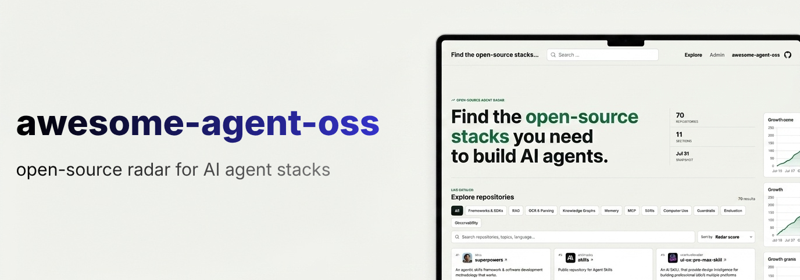

  

<h1 align="center">awesome-agent-oss</h1>

  Discover curated open-source tools for building AI agents and track how they grow over time.

  
  

  <a href="https://awesomeagent.vercel.app">
    <strong>Explore at Website &rarr;</strong>
  </a>

  <a href="#how-rankings-work">How Rankings Work</a>
  &nbsp;·&nbsp;
  <a href="https://github.com/skan0779/awesome-agent-oss/issues/new?template=repository-suggestion.yml">Suggest a Repository</a>

---

## How Rankings Work

- Repositories are discovered through GitHub topics and manually reviewed before publication.
- Stars, forks, releases, and repository activity are collected daily from the GitHub API.
- Radar Score combines overall adoption with star-growth signals across 1, 3, 7, 30, and 60 days.
- Newer repositories are ranked with lower confidence until enough daily history is available.

 

---

<!-- AWESOME_AGENT_OSS:START -->
_🚀 Last updated from snapshot: `2026-11-11 06:10 UTC`._

## [Trending This Week](https://awesomeagent.vercel.app/#trending)

| Rank | Repository | Stars 1d | Stars 7d | Total Stars |
| ---: | --- | ---: | ---: | ---: |
| 1 | [D4Vinci/Scrapling](https://github.com/D4Vinci/Scrapling) | +537 | +6,028 | 101,272 |
| 2 | [Nutlope/hallmark](https://github.com/Nutlope/hallmark) | +794 | +5,586 | 52,782 |
| 3 | [anthropics/skills](https://github.com/anthropics/skills) | +1,143 | +5,386 | 192,566 |
| 4 | [DietrichGebert/ponytail](https://github.com/DietrichGebert/ponytail) | +606 | +4,625 | 188,541 |
| 5 | [affaan-m/ECC](https://github.com/affaan-m/ECC) | +551 | +4,224 | 300,912 |
| 6 | [obra/superpowers](https://github.com/obra/superpowers) | +556 | +3,860 | 315,857 |
| 7 | [Graphify-Labs/graphify](https://github.com/Graphify-Labs/graphify) | +593 | +3,792 | 145,763 |
| 8 | [thedotmack/claude-mem](https://github.com/thedotmack/claude-mem) | +396 | +3,760 | 115,922 |
| 9 | [Leonxlnx/taste-skill](https://github.com/Leonxlnx/taste-skill) | +428 | +3,455 | 113,087 |
| 10 | [HKUDS/DeepTutor](https://github.com/HKUDS/DeepTutor) | +329 | +3,248 | 58,072 |

 

## [Frameworks & SDKs](./sections/frameworks.md)

Frameworks and SDKs for building, orchestrating, and running AI agents.

| Rank | Repository | Stars | Forks | Updated | Latest release | License |
| ---: | --- | ---: | ---: | --- | --- | --- |
| 1 | [ruvnet/ruflo](https://github.com/ruvnet/ruflo) | 81,450 | 9,590 | 2026-11-11 | v3.75.3 (2026-11-10) | MIT |
| 2 | [headroomlabs-ai/headroom](https://github.com/headroomlabs-ai/headroom) | 79,329 | 6,201 | 2026-11-11 | v0.44.0 (2026-11-10) | Apache-2.0 |
| 3 | [langchain-ai/langgraph](https://github.com/langchain-ai/langgraph) | 44,774 | 7,714 | 2026-11-11 | sdk==0.4.14 (2026-11-06) | MIT |
| 4 | [langchain-ai/langchain](https://github.com/langchain-ai/langchain) | 149,339 | 25,104 | 2026-11-10 | langchain-core==1.7.7 (2026-11-10) | MIT |
| 5 | [crewAIInc/crewAI](https://github.com/crewAIInc/crewAI) | 60,748 | 9,146 | 2026-11-10 | 1.15.39 (2026-11-09) | MIT |
| 6 | [bytedance/deer-flow](https://github.com/bytedance/deer-flow) | 85,234 | 11,997 | 2026-11-11 | v2.2.0 (2026-11-04) | MIT |
| 7 | [aaif-goose/goose](https://github.com/aaif-goose/goose) | 56,441 | 6,576 | 2026-11-11 | v1.59.0 (2026-11-10) | Apache-2.0 |
| 8 | [ScrapeGraphAI/Scrapegraph-ai](https://github.com/ScrapeGraphAI/Scrapegraph-ai) | 32,708 | 3,336 | 2026-10-06 | v2.3.1 (2026-10-06) | MIT |
| 9 | [langchain-ai/deepagents](https://github.com/langchain-ai/deepagents) | 31,186 | 4,406 | 2026-11-11 | deepagents==0.7.35 (2026-11-09) | MIT |
| 10 | [HKUDS/nanobot](https://github.com/HKUDS/nanobot) | 50,002 | 8,728 | 2026-11-11 | v0.4.1 (2026-11-06) | MIT |

## [Platforms & Apps](./sections/platforms-apps.md)

Self-hosted platforms and applications for building, deploying, and operating AI agents.

| Rank | Repository | Stars | Forks | Updated | Latest release | License |
| ---: | --- | ---: | ---: | --- | --- | --- |
| 1 | [HKUDS/DeepTutor](https://github.com/HKUDS/DeepTutor) | 58,072 | 7,069 | 2026-11-07 | v1.7.2 (2026-11-06) | Apache-2.0 |
| 2 | [farion1231/cc-switch](https://github.com/farion1231/cc-switch) | 153,454 | 10,082 | 2026-11-11 | v4.0.29 (2026-11-10) | MIT |
| 3 | [666ghj/MiroFish](https://github.com/666ghj/MiroFish) | 85,225 | 12,919 | 2026-10-16 | v0.1.2 (2026-03-07) | AGPL-3.0 |
| 4 | [lobehub/lobehub](https://github.com/lobehub/lobehub) | 84,930 | 16,216 | 2026-11-11 | v2.3.2 (2026-11-06) | Other |
| 5 | [langgenius/dify](https://github.com/langgenius/dify) | 160,921 | 25,453 | 2026-11-11 | 1.19.0 (2026-11-04) | Other |
| 6 | [n8n-io/n8n](https://github.com/n8n-io/n8n) | 210,058 | 61,440 | 2026-11-11 | n8n@2.47.3 (2026-11-09) | Other |
| 7 | [Untrivial-ai/agent-orchestrator](https://github.com/OrchestratorInc/agent-orchestrator) | 14,409 | 1,962 | 2026-11-11 | v0.14.10 (2026-11-06) | Apache-2.0 |
| 8 | [agentscope-ai/QwenPaw](https://github.com/agentscope-ai/QwenPaw) | 37,598 | 3,272 | 2026-11-10 | v2.2.2.post1 (2026-10-22) | Apache-2.0 |
| 9 | [danny-avila/LibreChat](https://github.com/LibreChat-AI/LibreChat) | 46,952 | 9,670 | 2026-11-11 | - | MIT |
| 10 | [bytedance/deer-flow](https://github.com/bytedance/deer-flow) | 85,234 | 11,997 | 2026-11-11 | v2.2.0 (2026-11-04) | MIT |

## [AI Gateways](./sections/ai-gateways.md)

Gateways for routing, securing, observing, and managing access to AI model providers.

| Rank | Repository | Stars | Forks | Updated | Latest release | License |
| ---: | --- | ---: | ---: | --- | --- | --- |
| 1 | [maximhq/bifrost](https://github.com/maximhq/bifrost) | 9,489 | 1,573 | 2026-11-11 | ent-v2.5.1-base (2026-11-10) | Apache-2.0 |
| 2 | [IBM/mcp-context-forge](https://github.com/IBM/mcp-context-forge) | 4,796 | 965 | 2026-11-10 | v1.1.1 (2026-11-10) | Apache-2.0 |
| 3 | [Portkey-AI/gateway](https://github.com/Portkey-AI/gateway) | 13,363 | 1,377 | 2026-05-25 | v1.15.2 (2026-01-12) | MIT |
| 4 | [Kong/kong](https://github.com/Kong/kong) | 44,378 | 5,240 | 2026-10-19 | 3.9.4 (2026-10-12) | Apache-2.0 |
| 5 | [mnfst/manifest](https://github.com/mnfst/llm-gateway) | 7,629 | 528 | 2026-11-09 | manifest@6.29.1 (2026-11-09) | MIT |
| 6 | [archestra-ai/archestra](https://github.com/archestra-ai/archestra) | 4,436 | 1,234 | 2026-11-11 | platform-v1.4.26 (2026-11-10) | Other |
| 7 | [algorithmicsuperintelligence/optillm](https://github.com/algorithmicsuperintelligence/optillm) | 4,340 | 401 | 2026-11-02 | v0.4.1 (2026-11-02) | Apache-2.0 |

## [RAG](./sections/rag.md)

Retrieval, indexing, and generation tools for grounding AI applications in external knowledge.

| Rank | Repository | Stars | Forks | Updated | Latest release | License |
| ---: | --- | ---: | ---: | --- | --- | --- |
| 1 | [Tencent/WeKnora](https://github.com/Tencent/WeKnora) | 37,139 | 5,133 | 2026-11-09 | v0.9.0 (2026-10-29) | Other |
| 2 | [infiniflow/ragflow](https://github.com/infiniflow/ragflow) | 93,992 | 11,299 | 2026-11-11 | v1.0.0 (2026-11-06) | Apache-2.0 |
| 3 | [VectifyAI/PageIndex](https://github.com/VectifyAI/PageIndex) | 40,356 | 3,474 | 2026-11-10 | v0.5.3 (2026-11-05) | MIT |
| 4 | [Marker-Inc-Korea/AutoRAG](https://github.com/Marker-Inc-Korea/AutoRAG) | 5,652 | 496 | 2026-11-11 | v2.13.9 (2026-11-10) | Apache-2.0 |
| 5 | [Zleap-AI/SAG](https://github.com/Zleap-AI/SAG) | 2,919 | 211 | 2026-11-11 | v1.8.10 (2026-09-22) | MIT |
| 6 | [neuml/txtai](https://github.com/neuml/txtai) | 13,280 | 989 | 2026-11-10 | v9.14.0 (2026-10-06) | Apache-2.0 |
| 7 | [HKUDS/LightRAG](https://github.com/HKUDS/LightRAG) | 40,646 | 5,771 | 2026-11-11 | v1.5.7 (2026-09-02) | MIT |
| 8 | [StarTrail-org/PixelRAG](https://github.com/StarTrail-org/PixelRAG) | 10,901 | 981 | 2026-11-11 | v0.4.0 (2026-07-16) | Apache-2.0 |
| 9 | [HKUDS/RAG-Anything](https://github.com/HKUDS/RAG-Anything) | 24,483 | 2,865 | 2026-11-02 | v1.4.4 (2026-10-28) | MIT |
| 10 | [LearningCircuit/local-deep-research](https://github.com/LearningCircuit/local-deep-research) | 9,561 | 911 | 2026-11-11 | v2.0.0 (2026-11-07) | MIT |

## [OCR & Parsing](./sections/ocr.md)

OCR, document extraction, layout analysis, and structured document conversion.

| Rank | Repository | Stars | Forks | Updated | Latest release | License |
| ---: | --- | ---: | ---: | --- | --- | --- |
| 1 | [microsoft/markitdown](https://github.com/microsoft/markitdown) | 194,859 | 14,691 | 2026-11-07 | v0.1.9 (2026-10-21) | MIT |
| 2 | [opendatalab/MinerU](https://github.com/opendatalab/MinerU) | 83,469 | 6,925 | 2026-11-11 | mineru-4.2.0-released (2026-11-10) | Other |
| 3 | [docling-project/docling](https://github.com/docling-project/docling) | 70,410 | 5,309 | 2026-11-11 | v2.150.0 (2026-11-10) | MIT |
| 4 | [PaddlePaddle/PaddleOCR](https://github.com/PaddlePaddle/PaddleOCR) | 92,557 | 11,646 | 2026-09-16 | v3.7.0 (2026-06-11) | Apache-2.0 |
| 5 | [firecrawl/anydoc](https://github.com/firecrawl/anydoc) | 23,484 | 1,523 | 2026-10-23 | v0.2.4 (2026-08-27) | MIT |
| 6 | [hiroi-sora/Umi-OCR](https://github.com/hiroi-sora/Umi-OCR) | 48,573 | 4,740 | 2025-11-20 | v2.1.5 (2025-03-25) | MIT |
| 7 | [firecrawl/pdf-inspector](https://github.com/firecrawl/pdf-inspector) | 19,991 | 1,359 | 2026-10-22 | v1.25.2 (2026-09-28) | MIT |
| 8 | [opendataloader-project/opendataloader-pdf](https://github.com/opendataloader-project/opendataloader-pdf) | 30,276 | 2,900 | 2026-11-11 | v2.5.21 (2026-11-10) | Apache-2.0 |
| 9 | [tesseract-ocr/tesseract](https://github.com/tesseract-ocr/tesseract) | 77,454 | 10,910 | 2026-11-10 | 5.5.4 (2026-10-28) | Apache-2.0 |
| 10 | [oomol-lab/pdf-craft](https://github.com/oomol-lab/pdf-craft) | 6,590 | 484 | 2026-11-11 | v2.6.7 (2026-10-28) | MIT |

## [Knowledge Graphs](./sections/knowledge-graph.md)

Knowledge graph, graph database, and graph retrieval tools for AI applications.

| Rank | Repository | Stars | Forks | Updated | Latest release | License |
| ---: | --- | ---: | ---: | --- | --- | --- |
| 1 | [Graphify-Labs/graphify](https://github.com/Graphify-Labs/graphify) | 145,763 | 13,960 | 2026-11-10 | v0.9.106 (2026-11-10) | Apache-2.0 |
| 2 | [Egonex-AI/Understand-Anything](https://github.com/Egonex-AI/Understand-Anything) | 91,936 | 7,840 | 2026-11-11 | v2.9.0 (2026-07-10) | MIT |
| 3 | [getzep/graphiti](https://github.com/getzep/graphiti) | 32,730 | 3,363 | 2026-11-11 | v0.31.2 (2026-10-20) | Apache-2.0 |
| 4 | [semantica-agi/semantica](https://github.com/semantica-agi/semantica) | 14,528 | 1,713 | 2026-11-09 | v0.7.0 (2026-09-22) | MIT |
| 5 | [microsoft/graphrag](https://github.com/microsoft/graphrag) | 36,627 | 3,878 | 2026-11-09 | v3.3.0 (2026-10-08) | MIT |
| 6 | [open-metadata/OpenMetadata](https://github.com/open-metadata/OpenMetadata) | 15,736 | 2,505 | 2026-11-11 | 2.0.7-release (2026-10-27) | Apache-2.0 |
| 7 | [surrealdb/surrealdb](https://github.com/surrealdb/surrealdb) | 33,305 | 1,404 | 2026-11-09 | v4.0.1 (2026-11-09) | Other |
| 8 | [neo4j/neo4j](https://github.com/neo4j/neo4j) | 17,422 | 2,808 | 2026-11-06 | 3.2.0-alpha08 (2017-04-11) | GPL-3.0 |
| 9 | [SciPhi-AI/R2R](https://github.com/SciPhi-AI/R2R) | 8,083 | 654 | 2025-11-07 | v3.6.5 (2025-06-06) | MIT |
| 10 | [HelixDB/helix-db](https://github.com/HelixDB/helix-db) | 6,281 | 394 | 2026-11-10 | v3.6.2 (2026-11-10) | Apache-2.0 |

## [Memory](./sections/memory.md)

Short-term, long-term, and persistent memory systems for AI agents.

| Rank | Repository | Stars | Forks | Updated | Latest release | License |
| ---: | --- | ---: | ---: | --- | --- | --- |
| 1 | [thedotmack/claude-mem](https://github.com/thedotmack/claude-mem) | 115,922 | 10,054 | 2026-11-11 | v15.16.1 (2026-11-11) | Apache-2.0 |
| 2 | [vectorize-io/hindsight](https://github.com/vectorize-io/hindsight) | 60,348 | 7,359 | 2026-11-10 | v1.2.1 (2026-11-10) | MIT |
| 3 | [volcengine/OpenViking](https://github.com/volcengine/OpenViking) | 41,982 | 3,442 | 2026-11-11 | v0.5.4.1 (2026-11-11) | AGPL-3.0 |
| 4 | [TencentCloud/TencentDB-Agent-Memory](https://github.com/TencentCloud/TencentDB-Agent-Memory) | 30,773 | 3,001 | 2026-11-10 | v2.0.3 (2026-10-26) | Other |
| 5 | [DeusData/codebase-memory-mcp](https://github.com/DeusData/codebase-memory-mcp) | 48,463 | 4,012 | 2026-11-11 | v0.12.1 (2026-10-16) | MIT |
| 6 | [mem0ai/mem0](https://github.com/mem0ai/mem0) | 68,777 | 8,184 | 2026-11-06 | ts-v3.3.1 (2026-09-25) | Apache-2.0 |
| 7 | [topoteretes/cognee](https://github.com/topoteretes/cognee) | 33,234 | 3,500 | 2026-11-11 | v1.6.7 (2026-11-06) | Apache-2.0 |
| 8 | [getzep/graphiti](https://github.com/getzep/graphiti) | 32,730 | 3,363 | 2026-11-11 | v0.31.2 (2026-10-20) | Apache-2.0 |
| 9 | [AgriciDaniel/claude-obsidian](https://github.com/AgriciDaniel/claude-obsidian) | 16,331 | 1,602 | 2026-10-25 | v3.0.1 (2026-10-21) | MIT |
| 10 | [rohitg00/agentmemory](https://github.com/rohitg00/agentmemory) | 30,278 | 2,689 | 2026-11-11 | v0.9.33 (2026-11-09) | Apache-2.0 |

## [MCP](./sections/mcp.md)

Model Context Protocol servers, clients, SDKs, registries, and tool integrations.

| Rank | Repository | Stars | Forks | Updated | Latest release | License |
| ---: | --- | ---: | ---: | --- | --- | --- |
| 1 | [homeassistant-ai/ha-mcp](https://github.com/homeassistant-ai/ha-mcp) | 6,801 | 438 | 2026-11-11 | v9.1.2 (2026-11-08) | MIT |
| 2 | [DeusData/codebase-memory-mcp](https://github.com/DeusData/codebase-memory-mcp) | 48,463 | 4,012 | 2026-11-11 | v0.12.1 (2026-10-16) | MIT |
| 3 | [upstash/context7](https://github.com/upstash/context7) | 64,551 | 3,237 | 2026-11-10 | @upstash/context7-mcp@4.6.0 (2026-11-09) | MIT |
| 4 | [ChromeDevTools/chrome-devtools-mcp](https://github.com/ChromeDevTools/chrome-devtools-mcp) | 55,085 | 4,581 | 2026-11-11 | chrome-devtools-mcp-v1.12.0 (2026-10-22) | Apache-2.0 |
| 5 | [punkpeye/awesome-mcp-servers](https://github.com/punkpeye/awesome-mcp-servers) | 97,584 | 19,677 | 2026-11-06 | - | MIT |
| 6 | [oraios/serena](https://github.com/oraios/serena) | 31,278 | 2,136 | 2026-11-09 | v2.1.0 (2026-10-19) | Other |
| 7 | [CoplayDev/unity-mcp](https://github.com/CoplayDev/unity-mcp) | 15,871 | 1,633 | 2026-10-30 | v10.3.0 (2026-10-04) | MIT |
| 8 | [0x4m4/hexstrike-ai](https://github.com/0x4m4/hexstrike-ai) | 13,508 | 2,741 | 2026-08-03 | - | MIT |
| 9 | [xpzouying/xiaohongshu-mcp](https://github.com/xpzouying/xiaohongshu-mcp) | 17,075 | 2,510 | 2026-11-10 | v2.7.4 (2026-11-10) | Apache-2.0 |
| 10 | [github/github-mcp-server](https://github.com/github/github-mcp-server) | 34,378 | 5,326 | 2026-11-10 | v2.1.0 (2026-11-03) | MIT |

## [Skills](./sections/skills.md)

Reusable skills, instructions, and workflow packages for AI agents.

| Rank | Repository | Stars | Forks | Updated | Latest release | License |
| ---: | --- | ---: | ---: | --- | --- | --- |
| 1 | [DietrichGebert/ponytail](https://github.com/DietrichGebert/ponytail) | 188,541 | 10,482 | 2026-10-29 | v5.3.3 (2026-10-29) | MIT |
| 2 | [Nutlope/hallmark](https://github.com/Nutlope/hallmark) | 52,782 | 2,803 | 2026-11-10 | - | MIT |
| 3 | [D4Vinci/Scrapling](https://github.com/D4Vinci/Scrapling) | 101,272 | 10,565 | 2026-11-09 | v0.5.1 (2026-11-04) | BSD-3-Clause |
| 4 | [anthropics/skills](https://github.com/anthropics/skills) | 192,566 | 22,668 | 2026-11-06 | - | - |
| 5 | [affaan-m/ECC](https://github.com/affaan-m/ECC) | 300,912 | 44,407 | 2026-11-09 | v2.2.3 (2026-10-01) | MIT |
| 6 | [Leonxlnx/taste-skill](https://github.com/Leonxlnx/taste-skill) | 113,087 | 7,617 | 2026-11-08 | v2.5.1 (2026-11-07) | MIT |
| 7 | [obra/superpowers](https://github.com/obra/superpowers) | 315,857 | 28,095 | 2026-11-03 | v7.0.2 (2026-11-03) | MIT |
| 8 | [blader/humanizer](https://github.com/blader/humanizer) | 67,661 | 5,318 | 2026-11-10 | v4.0.0 (2026-11-10) | MIT |
| 9 | [tt-a1i/archify](https://github.com/tt-a1i/archify) | 95,438 | 6,517 | 2026-11-11 | v3.2.0 (2026-10-19) | Apache-2.0 |
| 10 | [nextlevelbuilder/ui-ux-pro-max-skill](https://github.com/nextlevelbuilder/ui-ux-pro-max-skill) | 147,896 | 15,647 | 2026-11-10 | v2.15.0 (2026-08-13) | MIT |

## [Coding Agents](./sections/coding-agents.md)

Agents and development tools for writing, reviewing, debugging, and maintaining software.

| Rank | Repository | Stars | Forks | Updated | Latest release | License |
| ---: | --- | ---: | ---: | --- | --- | --- |
| 1 | [ruvnet/ruflo](https://github.com/ruvnet/ruflo) | 81,450 | 9,590 | 2026-11-11 | v3.75.3 (2026-11-10) | MIT |
| 2 | [alibaba/open-code-review](https://github.com/alibaba/open-code-review) | 49,812 | 3,670 | 2026-11-11 | v1.13.7 (2026-11-10) | Apache-2.0 |
| 3 | [Untrivial-ai/agent-orchestrator](https://github.com/OrchestratorInc/agent-orchestrator) | 14,409 | 1,962 | 2026-11-11 | v0.14.10 (2026-11-06) | Apache-2.0 |
| 4 | [backnotprop/plannotator](https://github.com/backnotprop/plannotator) | 10,018 | 758 | 2026-11-11 | v0.28.61 (2026-11-10) | Apache-2.0 |
| 5 | [omnigent-ai/omnigent](https://github.com/omnigent-ai/omnigent) | 11,329 | 1,877 | 2026-11-11 | v0.21.0 (2026-11-05) | Apache-2.0 |
| 6 | [kirodotdev/KiroCrew](https://github.com/kirodotdev/KiroCrew) | 4,884 | 1,014 | 2026-11-11 | v0.12.1 (2026-11-10) | Apache-2.0 |
| 7 | [google-gemini/gemini-cli](https://github.com/google-gemini/gemini-cli) | 108,766 | 14,925 | 2026-11-11 | v0.68.0 (2026-11-10) | Apache-2.0 |
| 8 | [MinishLab/semble](https://github.com/MinishLab/semble) | 6,395 | 289 | 2026-11-08 | v0.7.3 (2026-11-08) | MIT |
| 9 | [getsentry/XcodeBuildMCP](https://github.com/getsentry/MobileBuildMCP) | 6,562 | 328 | 2026-11-07 | v2.7.1 (2026-09-23) | MIT |
| 10 | [potpie-ai/potpie](https://github.com/potpie-ai/potpie) | 5,795 | 696 | 2026-10-30 | v2.0.1 (2026-08-31) | Apache-2.0 |

## [Sandboxes](./sections/sandboxes.md)

Isolated runtimes and execution environments for safely running agent-generated code and tools.

| Rank | Repository | Stars | Forks | Updated | Latest release | License |
| ---: | --- | ---: | ---: | --- | --- | --- |
| 1 | [nolabs-ai/nono](https://github.com/nolabs-ai/nono) | 4,926 | 331 | 2026-11-10 | v0.81.0 (2026-10-29) | Apache-2.0 |
| 2 | [microsoft/Orchard](https://github.com/microsoft/Orchard-Agentic) | 559 | 43 | 2026-11-07 | - | MIT |

## [Computer Use](./sections/computer-use.md)

Browser, desktop, and GUI automation for agents that operate software.

| Rank | Repository | Stars | Forks | Updated | Latest release | License |
| ---: | --- | ---: | ---: | --- | --- | --- |
| 1 | [Panniantong/Agent-Reach](https://github.com/Panniantong/Agent-Reach) | 110,962 | 9,933 | 2026-11-08 | v1.6.1 (2026-11-01) | MIT |
| 2 | [citrolabs/ego-lite](https://github.com/citrolabs/ego-lite) | 22,475 | 1,274 | 2026-11-11 | v2.2.0 (2026-11-05) | MIT |
| 3 | [browser-use/browser-use](https://github.com/browser-use/browser-use) | 120,646 | 13,482 | 2026-11-11 | 1.0.2 (2026-11-11) | MIT |
| 4 | [trycua/cua](https://github.com/trycua/cua) | 32,157 | 2,406 | 2026-11-11 | cua-spaces-v0.33.2 (2026-11-11) | MIT |
| 5 | [microsoft/playwright](https://github.com/microsoft/playwright) | 99,817 | 6,840 | 2026-11-11 | v1.65.0 (2026-11-05) | Apache-2.0 |
| 6 | [browser-use/browser-harness](https://github.com/browser-use/browser-harness) | 19,009 | 1,884 | 2026-11-11 | v0.1.13 (2026-09-04) | MIT |
| 7 | [jackwener/OpenCLI](https://github.com/jackwener/OpenCLI) | 31,011 | 3,037 | 2026-11-07 | v2.0.3 (2026-11-07) | Apache-2.0 |
| 8 | [web-infra-dev/midscene](https://github.com/web-infra-dev/midscene) | 15,579 | 1,219 | 2026-11-11 | v1.17.7 (2026-11-06) | MIT |
| 9 | [simular-ai/Agent-S](https://github.com/simular-ai/Agent-S) | 12,929 | 1,506 | 2026-10-30 | v0.3.2 (2025-12-16) | Apache-2.0 |
| 10 | [browserbase/stagehand](https://github.com/browserbase/stagehand) | 25,995 | 1,813 | 2026-11-11 | stagehand-server-v3/v3.7.7 (2026-10-23) | MIT |

## [Voice & Realtime](./sections/voice-realtime.md)

Speech, voice, and real-time multimodal systems for conversational AI agents.

| Rank | Repository | Stars | Forks | Updated | Latest release | License |
| ---: | --- | ---: | ---: | --- | --- | --- |
| 1 | [jamiepine/voicebox](https://github.com/jamiepine/voicebox) | 60,405 | 7,588 | 2026-10-07 | v0.5.0 (2026-04-25) | MIT |
| 2 | [microsoft/VibeVoice](https://github.com/microsoft/VibeVoice) | 56,987 | 6,422 | 2026-10-08 | - | MIT |
| 3 | [pipecat-ai/pipecat](https://github.com/pipecat-ai/pipecat) | 17,187 | 3,084 | 2026-11-11 | v1.15.0 (2026-10-29) | BSD-2-Clause |
| 4 | [livekit/agents](https://github.com/livekit/agents) | 15,169 | 4,116 | 2026-11-11 | livekit-agents@1.8.11 (2026-11-05) | Apache-2.0 |
| 5 | [kyutai-labs/pocket-tts](https://github.com/kyutai-labs/pocket-tts) | 10,258 | 1,099 | 2026-11-10 | v4.0.1 (2026-10-21) | MIT |
| 6 | [modelscope/FunASR](https://github.com/modelscope/FunASR) | 20,997 | 2,122 | 2026-11-11 | v1.4.24 (2026-11-08) | MIT |
| 7 | [huggingface/speech-to-speech](https://github.com/huggingface/speech-to-speech) | 13,675 | 1,689 | 2026-11-10 | v1.1.0 (2026-10-24) | Apache-2.0 |
| 8 | [TEN-framework/ten-framework](https://github.com/TEN-framework/ten-framework) | 11,228 | 1,378 | 2026-11-10 | 0.11.75 (2026-11-03) | Other |
| 9 | [supertone-inc/supertonic](https://github.com/supertone-oss-archive/supertonic) | 13,752 | 1,575 | 2026-09-09 | v2.0.0 (2026-01-06) | MIT |

## [Guardrails](./sections/guardrails.md)

Safety, validation, privacy, and security controls for LLM and agent applications.

| Rank | Repository | Stars | Forks | Updated | Latest release | License |
| ---: | --- | ---: | ---: | --- | --- | --- |
| 1 | [ifixai-ai/iFixAi](https://github.com/ifixai-ai/iFixAi) | 44,750 | 1,788 | 2026-11-09 | v4.3.0 (2026-10-22) | Apache-2.0 |
| 2 | [usestrix/strix](https://github.com/usestrix/strix) | 74,898 | 8,468 | 2026-11-11 | v1.7.1 (2026-11-10) | Apache-2.0 |
| 3 | [NVIDIA/SkillSpector](https://github.com/NVIDIA/SkillSpector) | 25,253 | 2,212 | 2026-11-11 | v2.13.4 (2026-11-04) | Apache-2.0 |
| 4 | [KeygraphHQ/shannon](https://github.com/KeygraphHQ/shannon) | 51,666 | 6,027 | 2026-11-10 | v3.5.0 (2026-10-27) | AGPL-3.0 |
| 5 | [0x4m4/hexstrike-ai](https://github.com/0x4m4/hexstrike-ai) | 13,508 | 2,741 | 2026-08-03 | - | MIT |
| 6 | [NVIDIA/garak](https://github.com/NVIDIA/garak) | 9,987 | 1,466 | 2026-11-06 | v0.17.1 (2026-10-16) | Apache-2.0 |
| 7 | [nolabs-ai/nono](https://github.com/nolabs-ai/nono) | 4,926 | 331 | 2026-11-10 | v0.81.0 (2026-10-29) | Apache-2.0 |
| 8 | [Tencent/AI-Infra-Guard](https://github.com/Tencent/AI-Infra-Guard) | 7,460 | 750 | 2026-11-11 | v4.6.9 (2026-11-05) | Apache-2.0 |
| 9 | [openai/codex-security](https://github.com/openai/codex-security) | 11,369 | 914 | 2026-11-11 | npm-v0.9.1 (2026-11-10) | Apache-2.0 |
| 10 | [NVIDIA-NeMo/Guardrails](https://github.com/NVIDIA-NeMo/Guardrails) | 7,472 | 900 | 2026-11-11 | v0.24.1 (2026-09-16) | Other |

## [Evaluation](./sections/evaluation.md)

Evaluation, benchmarking, testing, and scoring for LLM and agent systems.

| Rank | Repository | Stars | Forks | Updated | Latest release | License |
| ---: | --- | ---: | ---: | --- | --- | --- |
| 1 | [ifixai-ai/iFixAi](https://github.com/ifixai-ai/iFixAi) | 44,750 | 1,788 | 2026-11-09 | v4.3.0 (2026-10-22) | Apache-2.0 |
| 2 | [promptfoo/promptfoo](https://github.com/promptfoo/promptfoo) | 27,045 | 2,706 | 2026-11-11 | 0.125.1 (2026-10-25) | MIT |
| 3 | [comet-ml/opik](https://github.com/comet-ml/opik) | 23,325 | 1,943 | 2026-11-11 | 2.2.143 (2026-11-06) | Apache-2.0 |
| 4 | [confident-ai/deepeval](https://github.com/confident-ai/deepeval) | 19,425 | 2,191 | 2026-11-11 | python-v4.2.4 (2026-09-22) | Apache-2.0 |
| 5 | [mlflow/mlflow](https://github.com/mlflow/mlflow) | 28,753 | 6,608 | 2026-11-11 | v3.18.0 (2026-11-04) | Apache-2.0 |
| 6 | [vibrantlabsai/ragas](https://github.com/vibrantlabsai/ragas) | 16,289 | 1,807 | 2026-02-24 | v0.4.3 (2026-01-13) | Apache-2.0 |
| 7 | [UKGovernmentBEIS/inspect_ai](https://github.com/UKGovernmentBEIS/inspect_ai) | 3,224 | 925 | 2026-11-11 | 0.3.289 (2026-11-10) | MIT |
| 8 | [MatrAIx-ai/MatrAIx-Persona-8B](https://github.com/MatrAIx-ai/MatrAIx-Persona-8B) | 2,102 | 360 | 2026-09-18 | - | MIT |
| 9 | [truera/trulens](https://github.com/truera/trulens) | 3,638 | 391 | 2026-11-10 | trulens-2.16.0 (2026-10-19) | MIT |
| 10 | [raga-ai-hub/RagaAI-Catalyst](https://github.com/raga-ai-hub/RagaAI-Catalyst) | 16,195 | 3,572 | 2026-02-11 | v2.2.4 (2025-06-23) | Apache-2.0 |

## [Observability](./sections/observability.md)

Tracing, monitoring, and production analytics for LLM and agent systems.

| Rank | Repository | Stars | Forks | Updated | Latest release | License |
| ---: | --- | ---: | ---: | --- | --- | --- |
| 1 | [langfuse/langfuse](https://github.com/langfuse/langfuse) | 37,278 | 4,196 | 2026-11-11 | v4.78.0 (2026-11-10) | Other |
| 2 | [comet-ml/opik](https://github.com/comet-ml/opik) | 23,325 | 1,943 | 2026-11-11 | 2.2.143 (2026-11-06) | Apache-2.0 |
| 3 | [Tracer-Cloud/opensre](https://github.com/Tracer-Cloud/opensre) | 12,810 | 1,877 | 2026-11-11 | v0.1.2026.11.11 (2026-11-11) | Apache-2.0 |
| 4 | [Arize-ai/phoenix](https://github.com/Arize-ai/phoenix) | 12,239 | 1,285 | 2026-11-11 | @arizeai/phoenix-cli@1.22.0 (2026-11-11) | Other |
| 5 | [getagentseal/codeburn](https://github.com/getagentseal/codeburn) | 11,762 | 907 | 2026-11-09 | desktop-v0.9.28 (2026-11-08) | MIT |
| 6 | [openlit/openlit](https://github.com/openlit/openlit) | 3,010 | 480 | 2026-11-10 | openlit-2.1.1 (2026-10-26) | Apache-2.0 |
| 7 | [mlflow/mlflow](https://github.com/mlflow/mlflow) | 28,753 | 6,608 | 2026-11-11 | v3.18.0 (2026-11-04) | Apache-2.0 |
| 8 | [SigNoz/signoz](https://github.com/SigNoz/signoz) | 32,580 | 2,592 | 2026-11-11 | v0.149.0 (2026-11-04) | Other |
| 9 | [builderz-labs/mission-control](https://github.com/builderz-labs/mission-control) | 6,474 | 134 | 2026-11-09 | v2.3.0 (2026-07-25) | MIT |
| 10 | [open-telemetry/opentelemetry-collector](https://github.com/open-telemetry/opentelemetry-collector) | 7,753 | 2,342 | 2026-11-10 | v0.165.0 (2026-11-06) | Apache-2.0 |

## [UI/UX](./sections/ui-ux.md)

User interfaces, clients, and workspaces for interacting with AI and agent systems.

| Rank | Repository | Stars | Forks | Updated | Latest release | License |
| ---: | --- | ---: | ---: | --- | --- | --- |
| 1 | [nextlevelbuilder/ui-ux-pro-max-skill](https://github.com/nextlevelbuilder/ui-ux-pro-max-skill) | 147,896 | 15,647 | 2026-11-10 | v2.15.0 (2026-08-13) | MIT |
| 2 | [nexu-io/open-design](https://github.com/nexu-io/open-design) | 107,071 | 12,177 | 2026-11-11 | open-design-v0.27.1 (2026-11-10) | Apache-2.0 |
| 3 | [open-webui/open-webui](https://github.com/open-webui/open-webui) | 158,343 | 23,028 | 2026-11-11 | v0.13.3 (2026-11-08) | Other |
| 4 | [JCodesMore/ai-website-cloner-template](https://github.com/JCodesMore/ai-website-cloner-template) | 38,971 | 5,799 | 2026-11-10 | v0.6.1 (2026-10-05) | MIT |
| 5 | [ibelick/ui-skills](https://github.com/ibelick/ui-skills) | 10,948 | 525 | 2026-11-07 | v0.2.3 (2026-06-22) | MIT |
| 6 | [CopilotKit/CopilotKit](https://github.com/CopilotKit/CopilotKit) | 38,621 | 4,813 | 2026-11-11 | v1.85.0 (2026-11-06) | MIT |
| 7 | [assistant-ui/assistant-ui](https://github.com/assistant-ui/assistant-ui) | 13,055 | 1,323 | 2026-11-11 | @assistant-ui/core@0.3.34 (2026-11-10) | MIT |
| 8 | [nexu-io/html-anything](https://github.com/nexu-io/html-anything) | 9,496 | 903 | 2026-11-11 | - | Apache-2.0 |
| 9 | [grab/cursor-talk-to-figma-mcp](https://github.com/grab/cursor-talk-to-figma-mcp) | 7,101 | 796 | 2026-07-26 | - | MIT |
| 10 | [vercel/chatbot](https://github.com/vercel/chatbot) | 21,044 | 6,779 | 2026-11-03 | - | Other |
<!-- AWESOME_AGENT_OSS:END -->
